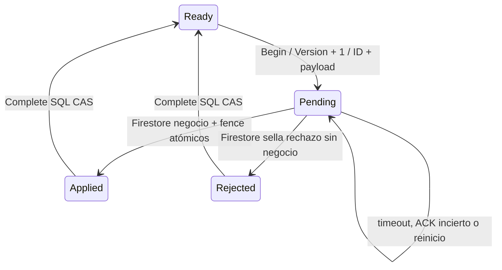

# RC-3 Sprint 4.1 — recuperación y consistencia

Fecha: 2026-10-19. Base recuperada: `16efe690278cb8bbab82ee2a3b6e9c2001147d5c`; anterior `4d1d0fb8fb2e8c5c9ef521253f9f0c0dadee54a1`.
El árbol estaba limpio. No se reconstruyó el protocolo ni se modificaron datos/servicios reales.

## Estado y veredicto

**P1 CORREGIDO localmente:** modelo, índice parcial, snapshot y scripts coherentes; historial conservado. Migración NO aplicada.

**P0 IMPLEMENTADO y ampliado con regresiones locales; certificación distribuida PENDIENTE.** Las dos carreras originales ahora rechazan la baja cuando la reserva gana; la reserva con lectura Firestore antigua se rechaza al avanzar el epoch. No se presenta SQLite/semáforos como prueba de PostgreSQL ni de atomicidad entre bases.

**SPRINT 4.1 NO APROBABLE como certificación completa / NO-GO de despliegue en esta ejecución.** Pendientes: ejecutar la matriz PostgreSQL/Firestore aislada descrita abajo y validar la duración/contención del bloqueo de ciclo de vida. El criterio de ausencia total de transacciones SQL durante IO remoto no se cumple literalmente: se conserva justificadamente la protección de borrado de tenant existente. Retirarla requiere resolver ese ciclo de vida; no se debilitó aislamiento para marcar ese criterio como cumplido.

## Recuperación del trabajo parcial

El commit parcial ya contenía interfaz/coordinador SQL, tabla de estados, fence Firestore, worker, DI, captura/validación en ReservationEngine, repositorios coordinados, migración/Designer/snapshot y adaptación de constructores/pruebas. No había archivos sintácticamente incompletos ni errores de compilación. Faltaban las pruebas de límites de fallo, SQL exportado y este documento; el progreso seguía describiendo Sprint 4.

Validación inmediata del commit recuperado: build correcto, 0 errores y tres warnings conocidos; **628 aprobadas, 0 fallidas, 0 omitidas**. La prueba histórica de migración Evolution ya seleccionaba su migración por nombre y conservaba sus aserciones; no se tocó durante esta recuperación.

## Defectos reproducidos y parches de recuperación

| Defecto | Evidencia / corrección |
|---|---|
| Intención crítica con snapshot viejo sobrescribe nombre/precio posterior | Prueba roja: nombre concurrente terminaba como `Service`. La intención SaveService ahora conserva UpdateTime UTC del documento observado; el callback transaccional exige esa versión. Conflicto sella Rejected, conserva la edición ganadora y pide recargar. Ediciones inocuas no toman una intención SQL ni cambian el epoch; su transacción tampoco puede restaurar campos críticos obsoletos. Ambas ordenaciones concurrentes tienen prueba. |
| Payload inválido permanece en bucle | Prueba roja con UnsupportedAction conservaba Pending tras dos workers. Se valida identidad/acción/tipo de servicio y se clasifica payload inválido. Con identidad válida se arbitra un marcador terminal Rejected en Firestore antes de completar SQL. Un intento válido antiguo no puede publicar después. Si Applied ya ganó, ese resultado prevalece. No se libera por un error de red/timeout/permisos. |
| Down PL/pgSQL sin terminador | Prueba roja del SQL generado: faltaba `END;`. Corregido únicamente en la migración nueva del sprint, no en migraciones históricas. |
| Worker omite ciclo de vida del tenant | Inspección: TenantIsolationMiddleware y OutboxProcessorWorker ya usaban TenantLifecycleLock; el nuevo worker no. Ahora toma la misma guarda y comprueba workspace existente/no Deleting antes de aplicar o sellar un rechazo. No se cambiaron autenticación, permisos ni borrado de tenants. |
| Rechazo funcional dentro de la guarda del worker | Completar SQL y después lanzar error de negocio haría rollback de esa finalización. La ruta de recuperación no relanza un resultado terminal Rejected; la API mantiene su 409/validación. Una integración local con coordinador SQL real adaptado comprueba que el worker confirma el rechazo y conserva la edición válida. |
| Repetición tras baja completada | Servicio ya inactivo/sede ya ausente y sin intención pendiente no generan otro epoch ni otra invalidación. La baja de sede repetida devuelve éxito sin escritura; no se duplica la operación tras ACK de finalización perdido. |

## Autoridades y protocolo

- PostgreSQL: `ReservationResourceStates`, PK `(WorkspaceId, Kind, ResourceId)`, Version bigint monotónica, PendingOperationId estable, PayloadJson jsonb y NextAttemptAt. FK a Workspace con cascada. SourceMessageId y xmin de reservas permanecen independientes.
- Firestore: datos comerciales y `workspaces/{workspace}/reservationResourceFences/{Kind_SHA256(ResourceId)}`. Marcador con Version, OperationId, Applied y error terminal. El marcador y la modificación comercial comparten la MISMA transacción Firestore, incluida la invalidación PDF existente.
- Redis no participa. No hay lock en memoria ni 2PC en producción.

### Reserva y reagendamiento

1. Replay por WorkspaceId+SourceMessageId devuelve la reserva durable existente antes de cualquier nueva escritura.
2. Capturar epochs SQL de sede y servicio **antes** de leer sedes/servicio/horarios/perfil Firestore.
3. Validar reglas y UTC mediante ReservationEngine existente; web y WhatsApp llegan al mismo motor. Reagendamiento sigue el mismo orden tras cargar la reserva.
4. Dentro del TransactionScope Serializable, adquirir `SELECT FOR UPDATE` de sede y servicio en orden estable. Exigir Version idéntica y ausencia de Pending tanto en observación como en fila actual.
5. Comprobar solapamiento, persistir reserva y Outbox en la misma transacción SQL. Mantener los row locks hasta commit/rollback; no hay Firestore dentro de esta transacción de recursos.
6. Cambios concurrentes/SQLSTATE existentes producen conflicto, descartan entidad/evento perdedores y permiten nueva consulta. No se cancela una reserva confirmada para compensar.

Los escritores de alta/reagendamiento encontrados están en ReservationEngine. Cancelar/completar no crean nuevos intervalos y mantienen su protección xmin. Productos no pasan por la coordinación de servicios.

### Modificación crítica

1. Capturar epoch SQL antes de observar el servicio Firestore. Normalizar/validar DTO usando reglas existentes. Comparar IsActive, RequiresReservation, Duration y alcance/sedes; nombre/precio solos no requieren intención.
2. BeginAsync abre transacción SQL breve ReadCommitted, bloquea la fila del recurso, verifica epoch y reservas futuras Confirmed (StartTime >= reloj UTC). Para retiro de sedes comprueba solo las afectadas cuando el resto de condiciones se conserva.
3. Reintento con mismo payload pendiente devuelve mismo ID/epoch; otro payload pendiente falla cerrado. Nueva intención incrementa Version y persiste ID/payload antes de cualquier IO Firestore. Se cierra la transacción SQL.
4. Transacción Firestore lee primero el marcador. Epoch mayor: operación antigua rechazada; mismo ID/epoch terminal: reutilizar resultado; misma versión con otro ID: fallo cerrado.
5. Validar documento, referencias y UpdateTime de SaveService; escribir negocio y marcador Applied, o sellar Rejected sin modificar el negocio. Un rechazo compite contra Applied mediante la misma lectura transaccional del fence.
6. Solo después de resultado terminal confirmado, completar SQL mediante CAS de workspace/tipo/recurso/epoch/ID. Nunca bajar Version. Fallo de SQL conserva el intento o permite observar su finalización si el commit ya ocurrió.

Servicios se desactivan lógicamente. Sedes conservan referencias, horas y principal bajo transacción. No se alteran reservas históricas, IDs, licencias ni zona horaria.

## Máquina de estados



Applied/Rejected se observan en Firestore; SQL permanece Pending hasta reconocerlos. NextAttemptAt y el límite de un intento NO son fechas de desbloqueo. Una operación anterior no puede completar una intención SQL nueva ni reemplazar un fence más reciente.

## Secuencia de reserva y baja

```mermaid
sequenceDiagram
    participant R as API reserva / WhatsApp
    participant S as PostgreSQL
    participant F as Firestore
    participant B as API baja / worker
    R->>S: Capturar epochs sede y servicio
    R->>F: Leer configuración autorizada
    B->>S: Lock recurso + comprobar futuras + persistir Pending
    S-->>B: Commit epoch nuevo
    R->>S: Serializable + locks Location, Service + validar epochs
    S-->>R: Conflicto; no reserva ni Outbox
    B->>F: Transacción negocio + fence Applied/Rejected
    F-->>B: Resultado terminal
    B->>S: Complete CAS de la intención
```

Si la reserva gana los locks y confirma primero, Begin de baja espera y después detecta la reserva futura; no modifica Firestore. Si ganó Begin, la reserva no puede validar el epoch viejo, aunque ya hubiese leído un servicio activo.

## Fallos y recuperación

| Ventana | Resultado seguro / recuperación |
|---|---|
| SQL falla antes del commit de intención | No se llama Firestore. Estado anterior disponible. |
| SQL confirma intención pero se pierde ACK | Pending durable; siguiente proceso recupera el mismo ID. No ejecutar otra intención incompatible. |
| Caída antes de Firestore | Worker reclama Pending, sin depender de la página o del proceso API original. |
| Firestore no responde | Pending permanece. El timeout no prueba rechazo ni libera el recurso. |
| Firestore confirma y se pierde ACK | La siguiente transacción lee el marcador terminal y no repite el negocio. |
| Firestore termina y SQL falla | Pending hasta reconocer el fence. CAS evita completar otra versión. |
| SQL completa pero se pierde ACK | Ready conserva Version; consulta/repetición reconoce el estado comercial terminal. |
| Dos workers o lease de intento vencida | Mismo ID/fence; solo un resultado comercial terminal. Los intentos pueden solaparse, la intención no expira. |
| Edición inocua durante intención crítica | UpdateTime difiere: rechazar el snapshot viejo, preservar datos ganadores; recargar antes de otro cambio. |
| Validación/payload inválido, identidad válida | Sellar rechazo atómico; completar SQL; aviso con WorkspaceId/OperationId, sin payload/PII. |
| Identidad/epoch corruptos, permisos o configuración de Firestore incorrectos | Fallar cerrado, no desbloquear ni borrar. Reparación administrativa separada y evidencia sanitizada; no se añadió endpoint inseguro de force-unlock. |
| Cancelación del host | Propagar cancelación; siguiente worker retoma Pending. |

El worker consulta hasta 10 intenciones por ciclo; CAS pospone un intento 30 s, ciclo 5 s. Un intento remoto tiene límite 30 s. Una fila inválida/configuración caída no autoriza alterar datos ni borrar historial. Los logs identifican operación, workspace y tipo de fallo, nunca claves ni datos de sesión.

### Duración de bloqueos y limitación de ciclo de vida

Los row locks de servicio/sede se limitan a transacciones SQL; no cubren las llamadas Firestore. Orden: Location y después Service, IDs ordinales; Begin afecta un solo recurso. Otros workspaces/recursos no comparten un lock global de recursos.

**Excepción explícita:** middleware de tenant ya retenía una transacción con advisory lock compartido durante la acción. El worker ahora respeta el mismo protocolo, comprueba no Deleting y confirma la finalización SQL dentro de esa guarda. Se conserva para no abrir un bypass frente a TenantDeletionWorker, que usa lock exclusivo. El límite por intento del worker es 30 s, no una garantía de latencia real. Implica conexiones ocupadas y espera del borrado; PostgreSQL real debe medir contención, cancelación, ACK incierto y recuperación. No se afirma que todas las transacciones SQL se cierren antes de IO. Eliminar esta excepción requiere coordinar durablemente el ciclo de vida del tenant y sus limpiezas; esa revisión no se improvisó ni amplió al borrado completo de tenants.

No se certificó el escenario combinado de eliminación nuclear del workspace, limpieza parcial de Firestore y commit remoto tardío. No borrar fences ni reiniciar epochs manualmente. No reutilizar IDs de workspace eliminados. Este límite permanece para validación de integración/decisión arquitectónica, sin afirmar una nueva garantía de limpieza externa.

## Modelo, migración y SQL

Se conserva la migración nueva existente `20261019170831_CoordinateReservationResourcesAndReuseCancelledSlots`, su Designer y snapshot generado por EF. En esta recuperación solo se corrige el terminador de Down; no se creó una segunda migración ni se editaron históricas.

- Up: tabla de coordinación + índice de recuperación; reemplaza únicamente el índice único de clave `(WorkspaceId, LocationId, ServiceId, StartTime)` por filtro **`"Status" <> 'Cancelled'`**.
- Estados reales: Confirmed, Cancelled, Completed y Pending. Disponibilidad ocupa todos salvo Cancelled; el filtro coincide. No se cambia el índice único independiente `(WorkspaceId, SourceMessageId)`, ni xmin, ni protección Serializable de intervalos superpuestos.
- Pruebas SQLite: dos cancelaciones históricas y una vigente con la misma clave; otra vigente rechazada; Confirmed/Pending/Completed ocupan; SourceMessageId sigue único incluso tras cancelar; reagendar a clave ocupada falla sin reescribir filas.
- Down: locks ACCESS EXCLUSIVE sobre ambas tablas; rechaza con SQLSTATE 55000 si existe **cualquier** fila de coordinación (incluso Ready) o claves históricas duplicadas. No borra reservas ni modifica historia para reconstruir el índice. La única sentencia DELETE del SQL exportado elimina la entrada EF de esa migración, después de las guardas.
- Mantener filas Ready preserva epochs frente a fences Firestore ya publicados; truncar/drop/recrear no es un rollback seguro.
- Scripts exportados: `backend/NexFlow.Infrastructure/Migrations/Sql/20261019170831_Up.sql` y `20261019170831_Down.sql`. Generados con EF offline, revisados estáticamente; **no ejecutados ni parseados por un servidor PostgreSQL**.

Herramientas offline (ya ejecutadas, no abren conexión): `dotnet ef migrations script ... --no-build --project backend/NexFlow.Infrastructure --startup-project backend/NexFlow.Infrastructure --output ... -- --offline`; `dotnet ef migrations has-pending-model-changes` con los mismos proyectos/flag. Resultado: **sin cambios pendientes del modelo**. Aviso de herramienta 10.0.10 frente a runtime 10.0.11; no se actualizó ninguna dependencia.

## Rollout y rollback seguros (NO ejecutados)

1. Inspección autorizada futura de DDL/índices reales, versión de PostgreSQL, migration history, duplicados y tamaños. No asumir que Oracle coincide con el snapshot.
2. Validar primero en entorno desechable aislado. Up usa DDL transaccional y CREATE INDEX sin CONCURRENTLY: puede bloquear escrituras; medir duración. Down ACCESS EXCLUSIVE bloquea también lecturas. Programar ventana; no improvisar CREATE INDEX CONCURRENTLY dentro de una transacción EF.
3. Detener admisión de escrituras y drenar TODAS las instancias/worker antiguos antes de habilitar nuevas escrituras. Una API previa no participa en fences: **rolling deploy mixto con escrituras NO es compatible**, aunque lea el esquema aditivo.
4. Aplicar la migración solo con autorización independiente, desplegar todas las APIs/workers compatibles y verificar matriz antes de reabrir tráfico.
5. Rollback de aplicación: conservar tabla/epochs/índice parcial y usar únicamente un artefacto compatible con este protocolo y su control UpdateTime. Volver a `4d1d0fb` o anterior con tráfico reintroduce la carrera. Si no hay artefacto compatible validado, pausar escrituras y corregir hacia delante.
6. Rollback de esquema: solo con aplicaciones detenidas y guardas satisfechas; después de uso normal Down será rechazado. No borrar/truncar metadatos ni historia para forzarlo; mantener esquema compatible es el camino seguro. Snapshot y campos de nombres históricos quedan fuera del sprint.

## Protocolo de integración futuro — PostgreSQL y Firestore aislados

No hay psql/postgres disponibles en PATH; no se instaló software ni se usó Oracle. Ejecutar esta matriz únicamente con autorización y bases desechables, nunca con credenciales/datos de producción:

1. Crear fixture de workspace/servicio/sede por API o seed de prueba. Aplicar Up en esa base aislada. Registrar versión del motor, DDL real e índice parcial; confirmar SourceMessageId/xmin y comparar modelo.
2. Dos conexiones PostgreSQL independientes: A inicia Serializable y bloquea Location, Service mediante los SELECT FOR UPDATE de producción; mantener la barrera hasta persistir reserva+Outbox. B intenta Begin del mismo recurso y debe esperar. Tras commit de A, B rechaza por reserva futura. Tras rollback de A, B puede persistir intención. Confirmar pg_locks/pg_stat_activity y liberación de locks al Dispose de TransactionScope, no al terminar el comando EF.
3. Invertir ganador: B persiste intención mientras A conserva snapshot Firestore viejo. Reanudar A mediante barreras deterministas de interceptor/fixture: debe devolver conflicto, sin reserva ni Outbox. Ejecutar API web y WhatsApp con proveedores simulados y servicios de dominio reales, procesos/DI y conexiones distintos.
4. Provocar dos transacciones Serializable con snapshots superpuestos sobre disponibilidad; exigir 40001/23505 según carrera y un solo intervalo activo, descartando entidades/eventos perdedores. Probar cancelación/reagendamiento concurrentes con xmin generado por PostgreSQL y solapamientos de distinta hora de inicio.
5. Con Firestore aislado, cortar ACK tras commit de negocio+fence; parar proceso tras intención SQL y tras Firestore antes de completar SQL; iniciar otro worker. Exigir mismo ID/epoch, un resultado comercial, sin desbloqueo por tiempo. Cortar ACK de commit SQL antes y después; verificar estado durable, no solo excepción cliente.
6. Reanudar un intento antiguo después de reactivar/reconfigurar con epoch nuevo; el dato y fence nuevo no cambian. Competir modificación crítica con nombre/precio en ambas ordenaciones; conservar exactamente el ganador y rechazar el otro, sin restaurar campos críticos viejos.
7. Medir independencia entre workspaces y recursos distintos; orden de locks estable y latencia/pool bajo contención. Verificar pending malformado/permisos RPC/cancelación de host, alertas por IDs y recuperación administrada sin SQL manual de desbloqueo.
8. Probar guarda compartida de tenant frente a lock exclusivo de borrado, worker ya reclamado, timeout/ACK incierto, reinicio y limpieza parcial. Esta integración y el coste de retener esa guarda son condiciones pendientes del P0; no inferirlos del stub SQLite.
9. Cancelar y reutilizar misma clave dos veces, conservar historia, rechazar dos vigentes; probar reagendamiento, SourceMessageId y estados. Ejecutar Down sobre base descartable con historial duplicado y con fila de coordinación: debe fallar explícitamente y la transacción no altera nada. En base sin uso, Down reconstruye el índice anterior.
10. Verificar ventana de rollout sin procesos antiguos; rollback solo de aplicación compatible manteniendo schema. Archivar resultados/correlaciones sanitizadas y errores SQL reales antes de emitir GO.

## Evidencia local y límites

Baseline recuperada: 628/628. Tres nuevas reproducciones rojas verificaron pérdida de nombre, intención inválida permanente y terminador Down; se conservaron sus condiciones y se corrigieron causas. La aserción nueva sobre DELETE del Down se precisó para permitir únicamente mantenimiento de `__EFMigrationsHistory`, nunca DML sobre reservas.

Dos suites nuevas ejercen las implementaciones Firestore con SDK/RPC en memoria y el coordinador SQL real sobre SQLite mediante adaptador explícito. El adaptador elimina FOR UPDATE, quita CAST jsonb y sustituye advisory lock por SELECT 1. Comprueba predicados/CAS/orden/alcance/transacciones EF; **no prueba bloqueos PostgreSQL, SSI, jsonb, 40001 reales ni durabilidad frente a caída de proceso/OS**. Reinicio local significa nuevos objetos/contextos sobre el mismo almacenamiento de fixture. No hubo procesos reales con PostgreSQL/Firestore de staging.

Resultado final y comandos exactos se registran en `NexFlow_RC3_PROGRESS.md`. No se modificó frontend, IA, notificaciones, n8n, PDF, secretos, AGENTS ni plan maestro. No se hizo commit, push, migración real ni despliegue. Sprint 5 NO autorizado.
