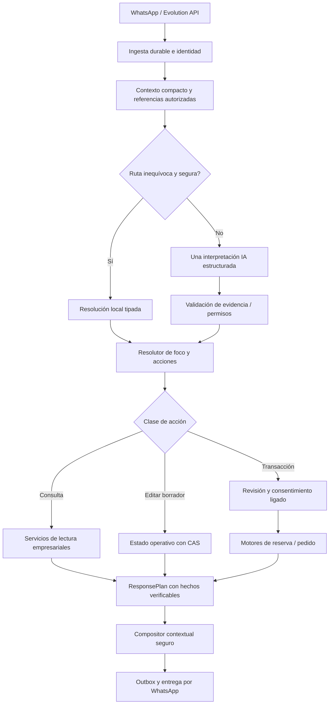

# NexFlow AI — Arquitectura CTA, brechas reales y hoja de ruta

**Fecha:** 31 de octubre de 2026  
**Estado:** propuesta de arquitectura + revisión estática dirigida; **no es una certificación de producción**.  
**Repositorio:** `saintdeyb321/NexFlow`  
**HEAD de `main` observado durante esta revisión:** `1ac887186d49ade0d6bcde6d117dfc9487557420` — *Correcion BOT pedidos*.  
**Versión anteriormente instalada en Oracle, según el último despliegue comunicado:** `aca4d7397d09a522c529d039fa21bb9c655cc158`. **No se verificó nuevamente Oracle** en esta revisión.  
**Documento de origen aportado:** `# NexFlow AI — Visión, arquitectura.txt` (versión 1.0, 31/10/2026).  
**Referencia externa:** demostración comercial de Axion Labs, **solo como referencia observable de UX**; no se conoce su arquitectura, prompting, costes, seguridad ni robustez reales.

> **Decisión:** convertir NexFlow en un **Contextual Transactional Agent (CTA)** mediante evolución del backend existente. No crear otro chatbot, no introducir agentes autónomos con acceso directo a las bases de datos y no reescribir prematuramente los motores de negocio.

---

## 1. Mandato de producto

NexFlow debe **comprender, recordar, orientar, ejecutar y verificar**.

- **Comprender:** intenciones explícitas e implícitas, errores de escritura, referencias como «ese», correcciones, negaciones, preguntas, cambios de tema y varios objetivos en un mensaje.
- **Recordar:** referencias vigentes, preguntas pendientes, preferencias y borradores operativos, preservados tras interrupciones y sin remitir historiales completos al modelo.
- **Orientar:** contestar la consulta, explicar qué falta, presentar hasta unas pocas opciones realmente ejecutables, ofrecer un siguiente paso concreto y usar ejemplos de formato como «03/11» o «3 de noviembre».
- **Ejecutar:** resolver catálogo/sedes/servicios/horarios y preparar operaciones por medio de los repositorios y motores existentes, nunca por órdenes libres del LLM.
- **Verificar:** datos autorizados, alcance del workspace, licencia, estado/versiones del borrador, consentimiento, idempotencia, concurrencia, trazabilidad y entrega incierta.

**Definición de éxito:** un cliente conversa sin aprender comandos; NexFlow responde con hechos válidos y permite volver a lo que estaba haciendo sin perder el trabajo, sin autorizar efectos por accidente y sin hacer llamadas al modelo innecesarias.

### Caso estrella de aceptación

1. «¿Tienen hilo dental?» → responde con datos publicados; no promete stock físico.
2. «¿Y cuánto cuesta ese?» → resuelve referencia válida y lee precio actual.
3. «Quiero dos» → prepara borrador de pedido y total verificado.
4. «Ah, también quiero cita para limpieza mañana» → **conserva el pedido** y cambia de foco hacia una reserva, sin confirmar ninguna operación.
5. «¿Qué horas tienen?» → consulta disponibilidad real de la sede y fecha; aclara sede si falta.
6. «Mejor volvamos al pedido» → recupera exactamente los 2 hilos dentales.
7. «Deja solo uno» → actualiza cantidad correcta y recalcula/revalida el resumen.
8. «Envía la solicitud» → presenta revisión vigente y pide consentimiento válido.
9. «Confirma el pedido, pero no la cita» → únicamente el pedido puede ejecutarse si se cumple el contrato de confirmación; ninguna reserva se crea.

**Esta conversación objetivo NO está certificada hoy**. Es la prueba rectora para medir el avance de la arquitectura.

## 2. Alcance de la comparación con Axion Labs

La demostración externa motivó el objetivo de orientar naturalmente y ofrecer acciones pertinentes. **No permite inferir**: si el producto externo usa tool-calling, memoria vectorial, multiagentes, varias llamadas de IA, un proveedor particular, precios actualizados o confirmaciones transaccionales seguras. No basar decisiones de NexFlow en supuestos sobre esa implementación.

La debilidad demostrada de NexFlow procede de la **conversación real de Sonrisa Andina Dental DEMO** y de la inspección del código: repeticiones de fallbacks, envío de pedido mal reconocido en algunos turnos y bloqueo explícito al cambiar de operación. El caso de una reserva confirmada inesperadamente sigue **sin causa raíz verificada**: podría existir retraso de un outbound anterior o un defecto real de consentimiento/estado. No atribuirlo al LLM ni darlo por resuelto sin correlación de evidencias.

## 3. Inventario de arquitectura actual: evidencia verificable

Los enlaces siguientes fijan el código de `1ac887...` y distinguen **implementado** de **deseado**.

| Capacidad | Implementación actual observada | Conclusión |
|---|---|---|
| Memoria persistente | [`ConversationContextDto`](https://github.com/saintdeyb321/NexFlow/blob/1ac887186d49ade0d6bcde6d117dfc9487557420/backend/NexFlow.Application/Abstractions/Cache/IConversationCache.cs): `CurrentGoal`, `CurrentStep`, `OrderDraftItems`, `CurrentQuestion`, `Information`, `StateVersion`. [`ContextRecoveryService`](https://github.com/saintdeyb321/NexFlow/blob/1ac887186d49ade0d6bcde6d117dfc9487557420/backend/NexFlow.Application/Features/Automation/ProcessMessage/Services/ContextRecoveryService.cs): Redis + estado durable. | **Implementada** la recuperación de un contexto estructurado; **no** un gestor formal de varias operaciones independientes. |
| Persistencia con CAS | [`FirestoreConversationStateRepository`](https://github.com/saintdeyb321/NexFlow/blob/1ac887186d49ade0d6bcde6d117dfc9487557420/backend/NexFlow.Infrastructure/Persistence/Firestore/FirestoreConversationStateRepository.cs): `contextJson`, `StateVersion` y transacción de actualización condicional. | **Implementada**; preservar este mecanismo en cualquier evolución. |
| IA estructurada | [`AiInterpreter`](https://github.com/saintdeyb321/NexFlow/blob/1ac887186d49ade0d6bcde6d117dfc9487557420/backend/NexFlow.Application/Features/AI/Interpretation/AiInterpreter.cs): JSON, `Intent`, `Act`, evidencia, propuestas de ítems y referencias. | **Implementada** para una intención primaria y varias ediciones dentro de pedidos. **No se observa un contrato general de varias intenciones independientes por turno.** |
| Enrutamiento híbrido | [`TurnUnderstandingPipeline`](https://github.com/saintdeyb321/NexFlow/blob/1ac887186d49ade0d6bcde6d117dfc9487557420/backend/NexFlow.Application/Features/Automation/Dialogue/Understanding/TurnUnderstandingPipeline.cs): resoluciones locales y escalamiento semántico. | **Parcial**: ya ahorra IA en casos claros, pero contiene heurísticas y decisiones sensibles al foco único; medir falsos positivos antes de ampliar reglas. |
| Diálogo contextual | [`AiResponseOrchestrator`](https://github.com/saintdeyb321/NexFlow/blob/1ac887186d49ade0d6bcde6d117dfc9487557420/backend/NexFlow.Application/Features/Automation/ProcessMessage/Services/AiResponseOrchestrator.cs): consulta/reanudación, enrutado y composición. | **Brecha confirmada**: bloquea iniciar `Order` con reserva activa o `Reservation` con pedido activo: exige terminar o descartar. |
| Consultas y referencias | [`CommerceTurnResolver`](https://github.com/saintdeyb321/NexFlow/blob/1ac887186d49ade0d6bcde6d117dfc9487557420/backend/NexFlow.Application/Features/Automation/Dialogue/Understanding/CommerceTurnResolver.cs), [`WorkspaceSlotResolver`](https://github.com/saintdeyb321/NexFlow/blob/1ac887186d49ade0d6bcde6d117dfc9487557420/backend/NexFlow.Application/Features/Automation/Dialogue/Understanding/WorkspaceSlotResolver.cs): lectura autorizada de catálogo/referencias. | **Parcial**; correcciones recientes existen, pero el comportamiento con proveedores reales no está verificado. |
| Pedido y consentimiento | [`OrderFlow`](https://github.com/saintdeyb321/NexFlow/blob/1ac887186d49ade0d6bcde6d117dfc9487557420/backend/NexFlow.Application/Features/Automation/ProcessMessage/Services/Flows/OrderFlow.cs): borrador, precio validado, fingerprint de revisión, consentimiento independiente, recuperación e idempotencia. | **Implementado**; no reemplazar con escritura dirigida por el LLM. |
| Reserva | [`ReservationEngine`](https://github.com/saintdeyb321/NexFlow/blob/1ac887186d49ade0d6bcde6d117dfc9487557420/backend/NexFlow.Application/Engines/Reservation/ReservationEngine.cs) + BookingFlow en `ConversationFlows.cs`. | **Implementado**; P0 de salida/confirmación inesperada sigue **pendiente de traza**. |
| Plan de respuesta | [`ResponsePlan`](https://github.com/saintdeyb321/NexFlow/blob/1ac887186d49ade0d6bcde6d117dfc9487557420/backend/NexFlow.Application/Features/Automation/Dialogue/Contracts/ResponsePlan.cs): hechos, opciones, datos faltantes, siguiente pregunta y fallback. | **Implementado**, buen punto de extensión; no crear un contrato paralelo sin justificación. |
| Presentación | [`ResponseComposer`](https://github.com/saintdeyb321/NexFlow/blob/1ac887186d49ade0d6bcde6d117dfc9487557420/backend/NexFlow.Application/Features/Automation/Dialogue/Composition/ResponseComposer.cs), [`SecretaryPresentation`](https://github.com/saintdeyb321/NexFlow/blob/1ac887186d49ade0d6bcde6d117dfc9487557420/backend/NexFlow.Application/Features/Automation/Dialogue/Composition/SecretaryPresentation.cs). | **Parcial**: IA de composición opt-in, limitada a agrupación de hechos verificados; otros casos usan texto local. No es redacción generativa amplia. |
| IA y coste | [`AiRouter`](https://github.com/saintdeyb321/NexFlow/blob/1ac887186d49ade0d6bcde6d117dfc9487557420/backend/NexFlow.Application/Features/AI/Router/AiRouter.cs): Groq para extracción, Gemini para otras tareas, fallback transitorio. [`AiTelemetry`](https://github.com/saintdeyb321/NexFlow/blob/1ac887186d49ade0d6bcde6d117dfc9487557420/backend/NexFlow.Application/Features/AI/Router/AiTelemetry.cs): intentos, latencia, tokens y volumen contextual. | **Métricas básicas implementadas**; no consta aquí una medición end-to-end de coste por conversación completada. |
| Control de presupuesto | [`FirestoreConversationStateRepository`](https://github.com/saintdeyb321/NexFlow/blob/1ac887186d49ade0d6bcde6d117dfc9487557420/backend/NexFlow.Infrastructure/Persistence/Firestore/FirestoreConversationStateRepository.cs): admisión de presupuesto IA por cliente/workspace. | **Implementado**; ajustar solo tras medir calidad. |
| Pruebas de reparación | [`WhatsAppConversationalRepairTests`](https://github.com/saintdeyb321/NexFlow/blob/1ac887186d49ade0d6bcde6d117dfc9487557420/backend/NexFlow.Tests/Concierge/WhatsAppConversationalRepairTests.cs): 28 casos reportados, integración controlada con JSON simulado. | **Valiosas pero insuficientes** para demostrar calidad semántica de Gemini/Groq real. |

**Nota sobre validaciones:** Codex reportó 1733 PASS / 1 FAIL en la última suite completa de la corrección previa, y una prueba dirigida exitosa tras el ajuste. No se ejecutó aquí la suite ni se declara gate completo verde. Se observaron cuatro workflows exitosos del SHA anterior `aca4d739...`, **no certifican automáticamente** `1ac887...`.

## 4. Brechas priorizadas

| ID | Brecha | Estado | Riesgo | Prioridad | Prueba que la demuestra o valida |
|---|---|---|---|---|---|
| B01 | Foco y operación transaccional están acoplados a un único `CurrentGoal` | **Defectuosa para el objetivo CTA**, confirmado en orquestador | El cliente debe terminar/descartar para cambiar de operación | **P1 / primera vertical** | Pedido abierto → solicitud de reserva → volver al pedido sin pérdida |
| B02 | El contexto no expone operaciones independientes con estados/preguntas por operación | **No implementado como contrato general**, inspección estática | Respuestas y consentimientos se podrían aplicar al borrador equivocado | **P1 / diseño antes de código** | Dos borradores y dos revisiones distintas, sin cruce de respuestas |
| B03 | Interpretación de varios objetivos heterogéneos en un mensaje | **No verificado como capacidad general; contrato principal singular** | Se omite parte de la petición o se ejecuta parcialmente | P2 | «Reserva mañana y quita un artículo», sin efectos imprevistos |
| B04 | Resolución referencial de productos/servicios y deícticos | **Parcial; corregido recientemente, sin prueba de proveedor real** | «Ese» puede identificar otro producto o pedir aclaración innecesaria | P1 | Referencia inequívoca/ambigua/vencida entre interrupciones |
| B05 | Opciones útiles y siguiente paso contextual consistentes | **Parcial** (`ResponsePlan` existe, mensajes siguen repartidos) | Bot parecido a formulario; aclaraciones en bucle | P2 | Respuestas muestran hechos y 1 acción/pregunta realmente disponibles |
| B06 | Coste por conversación terminada, latencia y repeticiones | **Medición incompleta** (telemetría por llamada sí existe) | Optimización artificial por menos tokens pero peor UX | P1 instrumental | Comparativo baseline vs candidato en mismo corpus |
| B07 | Trazabilidad de confirmación inesperada P0 | **Pendiente de prueba real** | Posible salida tardía o efecto no autorizado | **P0 seguridad** | Identificar origen/correlación/fingerprint/recibo de reserva |
| B08 | Compatibilidad de contextos persistidos y rollback | **Pendiente de diseño de migración** | Borradores antiguos pueden quedar inaccesibles | **P0 diseño antes de persistir** | Leer estado legacy sin perder, TTL, CAS y recuperación |
| B09 | Handoff, licencias, revocación y `UnknownDelivery` con múltiples focos | **Debe revalidarse al introducir cambios** | Fugas de tenant o doble envío | P0 invariante | Pruebas multi-tenant, takeover, fallo de entrega y replay |

**No confundir**: B01 es una brecha confirmada por código. B02/B03 son distancias frente al objetivo, no prueba de que cada interacción actual falle. B07 es un incidente pendiente de correlación, no una causa demostrada.

## 5. Arquitectura objetivo: CTA sobre componentes existentes



Este es un diagrama lógico. El control de autorización, concurrencia y tenancy ocurre **antes y durante** cada operación; no solo una vez al final. El usuario nunca interactúa directamente con comandos SQL, repositorios ni llamadas arbitrarias a herramientas generadas por la IA.

### Reutilización explícita

- **Entrada y durabilidad:** preservar la ingesta/webhooks, identificación del workspace, mensajes y Outbox actuales.
- **Memoria:** extender con cuidado `ConversationContextDto` y `ContextRecoveryService`; no abrir otra base de estado; reutilizar el `contextJson` duradero y CAS existente.
- **Comprensión:** evolucionar `DialogueTurnContext`, `AiInterpretation`, `TurnUnderstandingPipeline`, `CommerceTurnResolver` y resolutores de entidad. No implementar un nuevo intérprete por rubro.
- **Decisión:** adelgazar la lógica lingüística de `AiResponseOrchestrator` hacia decisiones tipadas, **solo donde los tests confirmen el problema**; evitar un segundo orquestador paralelo.
- **Negocio:** `OrderFlow`, BookingFlow, `ReservationEngine`, repositorios y servicios empresariales siguen siendo las únicas autoridades para efectos reales.
- **Respuesta:** conservar `ResponsePlan`; ampliar determinísticamente hechos, `NeededData`, `NextQuestion`, `Choices` y estilos de `SecretaryPresentation`.
- **Costos:** reutilizar `AiRouter`, `AiTelemetry`, presupuesto y control de fallos.

### Herramientas conceptuales (no endpoints ni interfaces nuevas por defecto)

`SearchCatalog`, `GetProductDetails`, `GetServices`, `GetAvailability`, `PrepareOrderChange`, `PrepareReservation`, `ConfirmOperation`, `RequestHumanHandoff` son **nombres de capacidades**, no APIs nuevas que deban implementarse literalmente. Mapearlos a servicios actuales. Distinguir lectura, cambio de borrador y confirmación irreversible.

## 6. Contratos conceptuales (propuestos; NO contratos productivos)

El cambio central es **separar el foco de conversación de los borradores**. Modelo ilustrativo:

```json
{
  "schemaVersion": 2,
  "activeFocus": { "kind": "reservation", "operationId": "local-reservation-draft-1" },
  "operations": [
    { "id": "local-order-draft-1", "kind": "order", "status": "suspended", "revision": 3 },
    { "id": "local-reservation-draft-1", "kind": "reservation", "status": "collecting", "revision": 1 }
  ],
  "references": [
    { "kind": "product", "entityId": "authorized-product-id", "scope": "workspace", "expiresAt": "timestamp" }
  ],
  "pendingQuestion": {
    "operationId": "local-reservation-draft-1", "expected": "time_preference"
  }
}
```

**No aplicar este JSON a Firestore directamente.** Codex debe evaluar el estado de dominio y el formato serializado real para elegir la modificación **mínima, aditiva y compatible**.

### Invariantes obligatorias del Context Manager

1. `workspaceId`/conversación verificadas; **ninguna** referencia o pregunta cruza tenants ni sesiones.
2. **Una sola operación en foco** en cada turno, aunque puedan existir borradores suspendidos limitados.
3. Cada borrador necesita `operationId`/tipo, revisión, fecha de expiración, fase y **pregunta asociada a esa operación**.
4. El estado operativo no puede ser reemplazado por un resumen libre inventado por el LLM.
5. Al suspender, no se hace commit ni se hereda consentimiento; la revisión debe revalidarse cuando se retoma.
6. Una respuesta «sí» solo puede vincularse a **una pregunta vigente y una operación**; nunca confirmar ambas.
7. Si se recibe «quita el segundo», la referencia debe estar ligada a una lista concreta, versión y orden actuales.
8. La actualización global debe preservar **CAS** y relectura ante concurrencia; evitar sobrescrituras silenciosas de dos focos.
9. Política inicial de capacidad: máximo **un borrador de pedido y uno de reserva**, y solo si la versión elegida soporta almacenamiento sin ambigüedad. No permitir varios de un tipo sin una desambiguación explícita.
10. Los contratos viejos siguen siendo válidos al leer contextos existentes; si no existe un campo nuevo, interpretar el estado legado antes de escribir uno nuevo.

### Esquema conceptual de decisión por turno

```json
{
  "primaryAct": "switch_focus",
  "recognizedRequests": [
    { "kind": "pause_order", "mode": "draft_only" },
    { "kind": "start_reservation", "mode": "collect" }
  ],
  "informationNeeded": ["location"],
  "allowedChoices": ["choose_location", "return_to_order", "human_handoff"],
  "writesAuthorized": false
}
```

**No exponer `writesAuthorized` a la IA como autoridad**: lo decide el backend. Puede haber acciones múltiples interpretadas, pero su aplicación la resuelve un plan determinista con operaciones asociadas a un borrador verificado. Para solicitudes compuestas que incluyan **dos escrituras** sobre stores distintos, v1 deberá pedir separar/confirmar las acciones o documentar un protocolo de compensación; no prometer atomicidad de una transacción global inexistente.

## 7. Router híbrido: cuándo usar IA

| Caso | IA objetivo | Precaución |
|---|---:|---|
| Botón/lista vigente con identidad de opción verificada | 0 | Validar pregunta, estado, módulo, expiración |
| Replay/idempotencia/doble webhook | 0 | Retornar mismo resultado, nunca repetir mutación |
| Respuesta inequívoca a `CurrentQuestion` (identidad vigente) | 0 | No inferir consentimiento desde un «ok» ambiguo |
| Consulta estructurada con referencia inequívoca y lectura autorizada | 0 si es seguro | Si hay ambigüedad, consultar IA o aclarar |
| Lenguaje natural, elipsis, corrección, cambio de foco | 1 inicial | IA devuelve JSON tipado y evidencia textual |
| Mensaje con varias intenciones | 1 inicial | Resolver cada acto por alcance; no lanzar todas las escrituras |
| Error transitorio del proveedor | fallback actual acotado | No crear cadenas de modelos ni reintentos indefinidos |

**Regla económica:** medir **costo por tarea completada correctamente**, no solo tokens por turno. Una ruta local que obliga a repetir la solicitud no es ahorro real.

### Contexto mínimo al modelo

Enviar únicamente: texto actual; foco; preguntas vigentes; referencias **autorizadas y vigentes**; productos/servicios relevantes (identificadores internos no necesarios al LLM, nombres mínimos); resumen de los borradores permitidos; zona/hora del negocio y capacidades autorizadas. No enviar todos los clientes, todo el catálogo, precios del resto del negocio, teléfonos, secretos, historiales extensos ni fingerprints de consentimiento.

## 8. Protocolo transaccional que NO se negocia

`Intención` → `Borrador` → `Revisión con hechos actuales` → `Consentimiento ligado a revisión y operación` → `Motor` → `Recibo/evidencia de efecto` → `Entrega`.

- La IA interpreta una intención de envío; **no firma** la confirmación.
- Precio, catálogo, sede, horarios, stock y disponibilidad deben provenir de fuentes autorizadas. Catálogo no es stock físico confirmado.
- El consentimiento identifica workspace, conversación, operación, versión/fingerprint del resumen, pregunta vigente y mensaje de origen de la respuesta; queda invalidado si se edita el borrador.
- Confirmaciones de reserva/pedido se mantienen en sus motores existentes, con idempotencia y deduplicación. **No alterar H06** ni convertir «de acuerdo» o un saludo en autorización incondicional.
- Un mensaje de confirmación tardío no puede transformarse en confirmación de un borrador nuevo. La salida tardía debe conservar `SourceMessageId` y causalidad.
- Fallo de entrega `UnknownDelivery` no autoriza reenvío automático de mensajes ni repetición de operaciones.
- Licencia, permisos y estado del canal/handoff se revalidan antes de lectura/escritura correspondiente.

### P0 de reserva inesperada

En la conversación DEMO, tras «Limpieza dental?» y la pregunta de fecha, apareció una confirmación de **Aplicación de flúor**, con datos no introducidos en esa secuencia visible. Las pruebas sintéticas de la corrección previa **no reproducen el defecto**; sí demuestran un replay antiguo con causalidad preservada. Para cerrar P0 hacen falta (con acceso privado y minimizado): identificación del mensaje fuente, timestamp de inbound/outbound, contexto anterior/posterior y versión, resumen/fingerprint, consentimiento, recibo persistido y correlación de entrega. Hasta entonces: no proclamar resuelta la causa; separar ejercicios de comprensión DEMO de confirmaciones reales si no hay certeza del canal.

## 9. Calidad de respuesta y experiencia UX

**Orden del compositor:** 1) contestar con dato verificado; 2) aclarar limitación relevante; 3) ofrecer siguiente opción o **una** pregunta útil; 4) conservar foco y borradores. Máximo de alternativas según canal/estado, evitando menús largos.

Ejemplos de estilo (datos solo ilustrativos, el sistema deberá leer la empresa real):

**Cliente:** «¿Está disponible el hilo dental?»  
**CTA:** «Tenemos *Hilo dental 50 m* publicado a S/ 12.90. No puedo confirmar existencias físicas desde el catálogo; el negocio debe revisarlas. ¿Quieres preparar una solicitud por cuántas unidades?»

**Cliente:** «Dame dos y ahora quiero una cita».  
**CTA:** «Dejo preparado tu pedido de 2 hilos dentales. También puedo ayudarte con una cita, sin enviar el pedido todavía. ¿En qué sede deseas atenderte?» *(solo si el sistema ya conserva el borrador y la transición es válida)*.

**Cliente:** «¿Qué día puedo ir?»  
**CTA:** «Indícame un día, por ejemplo «03/11», «3 de noviembre» o «mañana». Revisaré los horarios disponibles en tu sede.»

**Cliente:** «Volvamos al pedido».  
**CTA:** «Seguimos con los 2 hilos dentales por S/ 25.80 **si el precio actual sigue siendo ese**. ¿Quieres cambiar una cantidad o revisar el envío?»

Nunca llamar **confirmado** a un presupuesto, una consulta o una solicitud pendiente de revisión.

### Indicaciones para la redacción

- Respuestas breves, cálidas, profesionales; no repetir fórmulas como «conservamos» en todos los turnos.
- Usar `«...»` para ejemplos de entradas y acciones sugeridas, sin convertirlas en palabras mágicas obligatorias.
- Ajustar negocio, fechas y sedes según configuración, no texto específico de veterinaria o dental.
- Si el cliente preguntó algo factual, responder antes de ofrecer una operación.
- Si falta un dato, pedir el dato mínimo que desbloquea el avance, no repetir el formulario entero.
- Si hay dos referencias posibles, ofrecer dos opciones verificadas; no elegir por intuición.
- Cuando se rechaza una operación, explicar **por qué** y ofrecer opción factible (retomar, revisar, descartar, humano).

## 10. Matriz de pruebas de aceptación

Cada caso requiere: workspace, estado inicial, texto/acción, interpretación esperada, cambios exactos de contexto, lecturas permitidas, **efectos de dominio esperados y prohibidos**, respuesta/alternativas, número de llamadas de IA y origen de la evidencia.

| Caso | Escenario | Aserción imprescindible |
|---|---|---|
| C01 | Catálogo simple | Lectura verificada, sin inventar stock |
| C02 | «¿Y cuánto cuesta ese?» | Referencia inequívoca recuperada y precio actual |
| C03 | «¿Ese?» con dos entidades posibles | Pide aclaración, cero ediciones |
| C04 | Pedido abierto → intención reserva | Pedido no se pierde; política explícita de cambio de foco |
| C05 | Reserva abierta → volver al pedido | Ítems/cantidades iguales, revisión revalidada |
| C06 | «Deja solo uno» | Cantidad absoluta **1**, no sumar ni duplicar |
| C07 | Dos objetivos en un mensaje | Desambiguación/cambio seguro, sin efectos parciales sorprendentes |
| C08 | Fecha «mañana»/«03/11» y horarios | Zona real del workspace, disponibilidad por motor |
| C09 | «Envía la solicitud» + confirmación posterior | Solo una escritura tras consentimiento válido |
| C10 | Editar tras ver resumen | Fingerprint/consentimiento anterior invalidado |
| C11 | Webhook repetido, orden distinta, replay antiguo | Una escritura, mensaje de origen correcto |
| C12 | Fallo IA o rate limit | Estado intacto, alternativas útiles, gasto acotado |
| C13 | Referencia a otro workspace | No filtra datos ni resuelve entidad ajena |
| C14 | Intervención humana | Bot no continúa mutando tras takeover |
| C15 | Sin precio/stock/horario válido | No inventa; explica fuente/limitación |
| C16 | Interrupciones largas y reanudación | Borradores y preguntas correctos, sin historial completo al modelo |
| C17 | Errores «quieor», «conepcion» | Interpretación segura o aclaración concreta |
| C18 | Dos borradores del mismo tipo | Política explícita, nunca confunde cuál modificar |
| C19 | `UnknownDelivery`, reintento y mensaje tardío | No reenvío inseguro, no reatribución de confirmación |
| C20 | Conversación completa medida | Calidad y costo/latencia comparados sobre mismo corpus |
| C21 | Contexto legacy persistido | Se lee y conserva sin pérdida por campos opcionales nuevos |
| C22 | Dos respuestas «sí» para operaciones distintas | Vinculación a pregunta/fingerprint correcto, nunca dos commits |
| C23 | Catálogo revocado o precio cambiado | Revalidación y resumen actualizado antes de consentimiento |
| C24 | Cambiar foco con un borrador en confirmación | Suspender **invalida o preserva de forma segura** revisión, nunca autoriza en otro contexto |

**Niveles de validación diferentes:** (a) pruebas unitarias/fixtures con IA estructurada simulada; (b) integración del orquestador y stores aislados; (c) pruebas de prompts con proveedor real sin escrituras; (d) prueba E2E DEMO por Evolution/WhatsApp con efectos controlados. No declarar (d) porque pasó (a).

## 11. Métricas, objetivos y cómo medirlas

| Indicador | Definición | Meta propuesta inicial (no resultado) |
|---|---|---|
| Escenarios correctos | Casos aprobados / evaluables, con contexto + efectos verificados | ≥95%, iteración inicial, revisable por baseline |
| Integridad transaccional | Operaciones indebidas, duplicadas o sin revisión | **0** en todas las pruebas |
| Fuga de workspace | Exposición o ejecución entre tenants | **0** |
| Resolución de referencias | Referencias correctas / evaluables | ≥95%, objetivo orientativo |
| Costo completo | Tokens e importe por conversación **correctamente completada** | Mejorar vs misma muestra baseline; sin número inventado |
| IA por turno | Total de llamadas, fallback incluido / turnos | Medir por clase de turno; 0 en rutas inequívocas |
| Repreguntas inútiles | Solicitud repetida sin cambio de hecho/pregunta relevante | Reducir vs baseline |
| Latencia percibida | p50/p95 desde inbound hasta respuesta entregada/aceptada | Mejorar vs baseline, separando provider y canal |
| Recuperación | Casos de interrupción que retoman estado correcto | Medir, sin inventar tasas |

Instrumentación: conservar `AiTelemetry` (tokens, caracteres, roles de proveedor, latencia, intentos) y `ConversationDiagnostics`; correlacionar por **identificadores opacos** y tipos de resultado, sin PII ni contenido de mensajes. Si no hay dato de precios por modelo o uso reportado, clasificar **coste desconocido**, no cero.

El 95% es **propuesta de producto**, no certificación de NexFlow ni resultado de Axion Labs. P0 de seguridad y P0 de tenancy se evalúan como gates absolutos, no se promedian con UX.

## 12. Evolución incremental — orden y límites

### F0 — Congelar evidencia y localizar la primera brecha (sin implementar toda la visión)

- Verificar git HEAD, diff y staging local; preservar cambios previos.
- Construir una **línea base reproducible** del caso estrella con código y pruebas actuales.
- Registrar si el primer bloqueo sucede en comprensión, `CurrentGoal`, recuperación, selección de foco o presentación.
- Revisar P0 pendiente y no usar pruebas sintéticas como cierre de su causa real.
- Determinar si `contextJson` existente soporta un campo aditivo versionado sin cambios de infraestructura.
- Ejecutar pruebas **dirigidas** y recoger métricas sin usar Gemini/Groq real por defecto.

**Salida:** diagrama real, hipótesis verificadas y primera reproducción roja del bloqueo; no auditoría exhaustiva de todo el repo.

### F1 — Primera vertical: interrupción de operación y reanudación, sin múltiples efectos

**Meta:** pedido con 2 productos → cliente quiere reservar → se conserva el borrador, se puede cambiar de foco bajo una política explícita → cliente vuelve al pedido y recupera sus datos. No pedir borrar el pedido.

Implementación limitada y condicionada a la evidencia de F0:

1. Diferenciar `conversation focus` del `CurrentGoal` legado. Si se añade estado, que sea **opcional, versionado y guardado en el contexto durable actual**, no otro store.
2. Introducir **a lo sumo un borrador suspendido** en la primera versión, con identidad/revisión propia y expiración; no duplicar el estado íntegro global ni copiar versiones/fingerprints de consentimiento para crear autorizaciones.
3. Diseñar política de cambio y retorno por respuesta natural. Si el foco/resolución no son inequívocos, preguntar. Nunca crear dos operaciones definitivas por un solo turno.
4. Revalidar catálogo/servicios/horarios y licencia al retomar. Si existe revisión de pedido previa, exigir un nuevo resumen vigente antes de confirmar.
5. Asegurar CAS, takeover humano, expiración, replays, rollback de estado y ausencia de cambios en reservas/pedidos productivos.
6. Si surge incompatibilidad no resuelta de persistencia o transición, **parar la implementación de F1 y entregar el diseño y tests**, sin agregar hacks.

**Salida:** una vertical aislada en pruebas, flag seguro/desactivado por defecto cuando corresponda, sin reescribir los motores.

### F2 — Operaciones independientes (solo tras F1 estable)

- Modelo limitado de un pedido + una reserva abiertos, `operationId` y pregunta pendiente asociada a cada uno.
- Política de foco y suspensión automática/explicada según certeza y necesidad.
- Reanudación tras restart/TTL, revisión de compatibilidad con conversaciones legadas.
- No añadir dos borradores del mismo tipo ni ejecución compuesta sin política explícita.

### F3 — Intenciones múltiples y resolutor de acciones

- Extender interpretación estructurada para representar varios actos con evidencias y objetivos, sin conceder autoridad al modelo.
- Resolver conflictos, dependencia y qué partes requieren aclaración; para acciones mutables cruzadas, preferir secuenciación segura.
- Reutilizar los motores y herramientas autorizadas existentes.

### F4 — Respuestas contextualizadas

- Centralizar selección de opciones permitidas y pregunta siguiente sobre `ResponsePlan`.
- Compositor determinista por defecto; no aumentar llamadas solo para adornar.
- Experiencia natural para cada capacidad de negocio, no por frases fijas de un rubro.

### F5 — Optimización + validación en WhatsApp DEMO

- Medir calidad/costo/latencia por conversación completa antes/después.
- Probar modelos reales con datos sintéticos/sanitizados y límites acotados; después canal Evolution con números propios y sin clientes comerciales.
- Activación progresiva y reversión compatibles; **no desplegar solo porque pasaron fixtures**.

## 13. Criterios de GO/NO-GO

**GO para aceptar una fase local:** tests dirigidos, integraciones relevantes, comparación de contextos, efectos prohibidos igual a cero, diff revisable, sin cambios de infraestructura no aprobados. Una suite global con fallo no se declara verde; se investiga específicamente el fallo y su vínculo con el cambio.

**GO para prueba conversacional DEMO solo lectura:** permisos, identidad, límites de IA y proveedor real verificados, sin enviar comunicaciones externas no autorizadas.

**GO para transacciones DEMO:** asegurar correlación/consentimiento, ausencia de dobles efectos, resolver o aislar de modo explícito P0; no utilizar salida tardía como confirmación de operación actual.

**NO-GO para despliegue automático:** falta autorización expresa del propietario; aunque el SHA esté publicado no hay permiso implícito de tocar Oracle.

## 14. Restricciones no negociables para Codex

- Mantener .NET, PostgreSQL, Redis, Firestore, Evolution y servicios actuales salvo autorización expresa.
- Prohibido sustituir una brecha de comprensión por más `if` de lenguaje natural, listas de sinónimos o regex por cada frase del usuario.
- Prohibido permitir al LLM seleccionar tenant, ID ajeno, precio o cualquier escritura a repositorio.
- Prohibido debilitar H06, fingerprints de resumen, consentimiento, CAS, idempotencia, handoff, revocación de módulos o `UnknownDelivery`.
- No leer ni imprimir secretos/teléfonos/mensajes reales. No subir datos reales a pruebas ni LLM.
- No instalar frameworks de agentes, RAG, embeddings, vector DB o modelo mayor por defecto.
- No modificar API pública, esquema SQL, Firestore, Compose o configuración de Oracle sin justificar compatibilidad y obtener permiso.
- No modificar staging local preexistente; sin commit, push, migraciones o despliegue automático.
- No invertir tiempo en nuevas auditorías generales cuando una reproducción dirigida responde el problema.

## 15. Decisiones que quedan abiertas (deben resolverse por evidencia)

1. **Formato real de suspensión**: ¿snapshot selectivo de slots versus contenedor de operación versionado? Elegir el mínimo que preserve CAS y no vuelva incompatibles los contextos.
2. **Pregunta activa**: ¿cómo mantener la asociación de cada `CurrentQuestion` cuando se suspende/retoma un borrador? Evitar que un «Sí» confirme un resumen anterior.
3. **Capacidad inicial**: ¿cuánto estado suspendido tolera contextoJson actual? ¿TTL, limpieza y límites?
4. **Activación**: flag por workspace o global desactivado inicialmente; verificar el mecanismo existente antes de crear uno.
5. **Costo real**: preparar mediciones comparables entre versiones antes de cambiar modelo o aumentar contexto.
6. **P0 de reserva**: inspección de correlación privada de incidente sin inventar causa.

## 16. Entregables de trabajo esperados

1. **F0:** `docs/arquitectura/CTA_BRECHAS_REALES.md` (mapa de rutas con evidencia, baseline y decisiones mínimas).
2. **F1:** cambios pequeños de backend, pruebas multi-turno de estado y un informe con escenarios antes/después. Si F1 no es seguro todavía, entregable explícito de **NO-GO razonado** y tests rojos, no un parche especulativo.
3. **F2–F5:** prompts posteriores por fase, activados después de revisar el resultado de la anterior.

### Orden para comenzar

Abrir `NEXFLOW_CODEX_PROMPT_01_FOCO_CONTEXTO_2026-10-31.md` en Codex. Este prompt exige demostrar la brecha real, comprobar compatibilidad e implementar **solo la primera vertical segura**, o detenerse si no se pueden preservar los invariantes. No autoriza una reescritura integral.

---

**Nota final:** CTA es un nombre para organizar responsabilidades existentes y sus brechas. La ventaja buscada frente a una demo comercial no es mostrar texto más espectacular, sino **continuidad natural + acciones empresariales fiables + costos medibles**.
