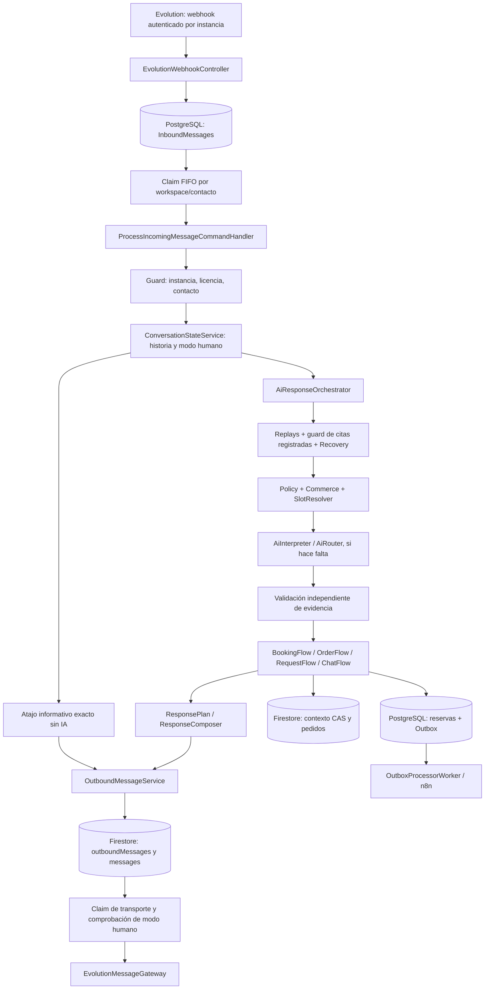
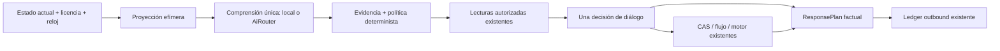

# Agent Runtime 4.0 — F0: baseline y diagnóstico arquitectónico

**Fecha:** 25/10/2026, America/Lima. **Alcance:** BLOQUE COMÚN + PROMPT 0. **Estado:** diagnóstico para auditoría G0; ninguna autorización de F1 ni de producción.

## 1. Identidad, límites y naturaleza de la evidencia

- Repositorio examinado: `C:\Proyectos\NexFlow`. Lectura directa de `.git/HEAD`: `ref: refs/heads/main`; lectura de `.git/refs/heads/main`: **`0da524d6e840ce6aeec77950d8e1f82b42c53e16`**, coincidente con la referencia documental del plan 4.0. No se ejecutó Git ni se consultó GitHub.
- Ese dato identifica la referencia local, **no acredita árbol limpio, igualdad del contenido con el commit, HEAD remoto ni imagen desplegada**. No se dispone de un diff contra el objeto del commit sin la comprobación adicional prohibida en este encargo. Los hallazgos se refieren a los archivos locales efectivamente leídos.
- Documentos obligatorios leídos completos: `AGENTS.md`, `docs/NEXFLOW_AGENT_RUNTIME_4_PLAN_MAESTRO.md`, `docs/NEXFLOW_AGENT_RUNTIME_4_PROMPTS_CODEX.md`. Por el bloque común también se leyó `NexFlow_Concierge_3_Plan_Maestro.md`; se contrastaron las secciones pertinentes de los informes de Sprint 4, 5 y 5.1/5.1.1 en `docs/concierge-3/`. Son antecedentes, no sustitutos del código.
- Único archivo creado por F0: este informe. Backend, frontend, pruebas, configuración, documentos anteriores y datos permanecen sin cambios realizados por esta auditoría. No builds, ejecución de pruebas, migraciones, emuladores, proveedores IA, WhatsApp ni servicios externos.
- Se tomó una huella de 69 archivos `.cs` relacionados para comprobar su estabilidad durante la escritura del informe. SHA-256 agregado de `ruta relativa + hash`, ordenado por ruta: `0CECC5DA47A5378538314F5F06BAA948866EDCA22763825CE9C426E61249BEED`. Es una huella de lectura local, **no un SHA de release ni una prueba de limpieza del repositorio**.

### Cómo interpretar las conclusiones

| Marca | Qué demuestra |
|---|---|
| **CE — confirmado estáticamente** | Rama, contrato, lectura o ausencia de dato verificable en los métodos citados. Una traza manual no equivale a ejecutar el backend. |
| **EH — evidencia histórica** | Contadores de un TRX o informe anterior; no atribuidos a una ejecución F0 ni a Oracle. |
| **HP — hipótesis pendiente** | Resultado que depende del modelo, configuración efectiva, datos o carrera no observados. |
| **DP — decisión de producto pendiente** | Requiere política/aprobación, no una corrección inferida por Codex. |

No se dispone en F0 de las trazas privadas del incidente, payloads exactos, configuración efectiva de proveedores ni datos del workspace. Por ello no se declara reproducido en producción ninguno de los escenarios relatados. No se ha confirmado un nuevo P0 de seguridad; permanecen riesgos P1 de continuidad y comprensión.

La inspección de permisos identificó además **F0-15, P1: acceso conversacional a FAQ sin comprobar el módulo FAQ**. Es una asimetría estática de autorización por módulo, no evidencia de fuga entre workspaces ni un incidente productivo observado. Requiere revisión prioritaria antes de ampliar herramientas.

## 2. Dictamen técnico y prioridades

La base **no necesita otro router, motor de reservas, estado persistido o framework de agentes**. Ya existen el router compartido, resolutores autorizados, propuestas tipadas, CAS y entrega durable. La deuda principal es la **competencia de varias capas para determinar el significado y la continuación del mismo turno**, con referencias conversacionales incompletas en la entrada del intérprete.

Prioridad propuesta:

1. **F1:** hacer explícita una pregunta/referencia vigente y una sola precedencia de decisión. El «sí» se intercepta hoy sin un identificador de pregunta y la invitación a empezar no tiene un contrato persistente equivalente al resumen final.
2. **F2:** dar a la comprensión acceso selectivo a hechos públicos y a referencias verificadas. Perfil/actividad no es una intención tipada del intérprete; RUC no es un dato automáticamente publicable.
3. **F3:** preguntar preferencia horaria antes de construir listas. Conservar la consulta puntual real del motor y todas sus garantías.
4. **F4:** admitir intención de preparar una solicitud todavía vacía; conservar `PendingReview`, confirmación, recibo único y notificación. No introducir pagos ni promesas de stock.
5. **F5–F6:** naturalidad verificable y economía medidas después de resolver decisiones; no gastar IA en aperturas de vocabulario fijo ni agregar caché autoritativa por intuición.

**Decisión F0:** entregable apto para revisión independiente. **G0 pendiente de aceptación del propietario/auditor.** NO-GO para declarar calidad comercial o iniciar F1 automáticamente.

## 3. Ruta real y fuentes de autoridad

Las rutas de código de este informe son relativas a `C:\Proyectos\NexFlow`; los números son líneas del checkout leído. Los métodos indicados permiten localizar cada evidencia sin depender de documentación histórica.



**Distinción esencial:** el Outbox PostgreSQL de eventos de reservas/automatización **no es la cola usada para cada respuesta WhatsApp**. Texto y PDF usan `OutboundMessageService` y el ledger Firestore; el worker Outbox dispara `IWorkflowGateway`. Un «Processed» del inbound o un `Sent` tras aceptar Evolution no demuestra entrega/lectura en el teléfono.

### Inventario de componentes y contratos

| Salto / clases | Autoridad y retornos reales | Evidencia |
|---|---|---|
| `EvolutionWebhookController.ReceiveMessage` | Valida clave por instancia, compatibilidad legacy y coherencia del envelope; resuelve workspace sin confiar en texto/LLM; normaliza contacto; persiste antes de HTTP 200. Los medios se clasifican, no se interpretan como texto comercial. | `backend/NexFlow.API/Controllers/Webhooks/EvolutionWebhookController.cs:30–117,158–185` |
| `InboundMessageRepository`, `InboundMessageWorker` | Deduplicación durable; selecciona el primer pendiente por workspace/instancia y teléfono, `SKIP LOCKED`; lote de 10. Valida nuevamente envelope/instancia. El claim conserva turno en una transacción SQL durante el procesamiento externo. Lease de recuperación 5 min; fallo reintentable bloquea sucesores; a 5 intentos termina en DeadLetter. | `backend/NexFlow.Infrastructure/Persistence/PostgreSQL/Repositories/InboundMessageRepository.cs:30–43,76–151,171–188`; `backend/NexFlow.Infrastructure/Workers/InboundMessageWorker.cs:36–86` |
| `IncomingMessageGuard` | Contacto normalizado, instancia vigente y licencia. No toma `WorkspaceId` de una interpretación. | `backend/NexFlow.Application/Features/Automation/ProcessMessage/Services/IncomingMessageGuard.cs:29–64` |
| `ConversationStateService`, `HumanHandoffService` | Historial de entrada, cierre de sesión inactiva sin objetivo, modo humano prioritario y aviso. Un medio no compatible recibe una explicación honesta. El handoff cambia conversación y contexto durable con nueva versión. | `backend/NexFlow.Application/Features/Automation/ProcessMessage/Services/ConversationStateService.cs:53–65,123–158`; `backend/NexFlow.Application/Features/Automation/Conversations/HumanHandoffService.cs:24–35`; `backend/NexFlow.Infrastructure/Persistence/Firestore/FirestoreConversationRepository.cs:388–412` |
| Handler: `TryHandleZeroTokenKnowledgeAsync` | Ubicaciones/horarios exactos pueden evitar todo el orquestador. Comprueba módulos antes de repositorios, no interfiere con borrador ni gestión de reserva y conserva alcance informativo. Persiste y envía por ledger. | `backend/NexFlow.Application/Features/Automation/ProcessMessage/ProcessIncomingMessageCommandHandler.cs:94–149` |
| `AiResponseOrchestrator` | Replays → guard de citas existentes → recovery → pipeline. Una respuesta/interpretación temprana omite capas posteriores. Revalida versión/modo/licencia tras interpretar y antes de entregar. Tiene además clasificación por regex y fallback propios. | `backend/NexFlow.Application/Features/Automation/ProcessMessage/Services/AiResponseOrchestrator.cs:65–159,180–258,276–316` |
| `ExistingReservationFlow`, `ReservationOperationClassifier` | Clasifica crear/borrador/cita registrada. Sin acreditación independiente, deriva a humano **antes** de consultar citas privadas. La implementación subyacente de gestión no constituye una capacidad habilitada para clientes. | `backend/NexFlow.Application/Features/Automation/ProcessMessage/Services/Flows/ExistingReservationFlow.cs:28–73`; `backend/NexFlow.Application/Features/Automation/Dialogue/Policy/ReservationOperationClassifier.cs:24–50` |
| `ConversationRecoveryService` | Interpretación local, menú, reparación, expiración, confirmación, selección y respuestas directas; guarda sus propios resultados de replay. Puede resolver completamente el turno sin pipeline/LLM. | `backend/NexFlow.Application/Features/Automation/ProcessMessage/Services/ConversationRecoveryService.cs:58–301,411–537` |
| `DialoguePolicy`, `TurnUnderstandingPipeline` | Clasifica acto, decide lecturas, resuelve localmente o consume presupuesto antes del intérprete. Genera propuestas de borrador; no concede consentimiento LLM. | `backend/NexFlow.Application/Features/Automation/Dialogue/Policy/DialoguePolicy.cs:20–105`; `backend/NexFlow.Application/Features/Automation/Dialogue/Understanding/TurnUnderstandingPipeline.cs:41–211` |
| `WorkspaceSlotResolver`, resolutores de entidades/nombre/fecha/hora | Catálogo y sedes autorizados del workspace; resultados determinados/ambiguos/inválidos/insuficientes. Proyección efímera con reloj del negocio. No persisten ni ejecutan. | `backend/NexFlow.Application/Features/Automation/Dialogue/Understanding/WorkspaceSlotResolver.cs:27–126`; `backend/NexFlow.Application/Features/Automation/Dialogue/Contracts/TurnUnderstanding.cs:8–84` |
| `CommerceTurnResolver`, `OrderMentionResolver`, `OfferingReference` | Decide consulta vs edición vs hipótesis/submit; resuelve productos/cantidades y referencias. No es una herramienta de stock ni pago. Sus puertas léxicas preceden al intérprete. | `backend/NexFlow.Application/Features/Automation/Dialogue/Understanding/CommerceTurnResolver.cs:19–92,95–150`; `backend/NexFlow.Application/Features/Automation/Dialogue/Understanding/OrderMentionResolver.cs:12–56,108–115` |
| `AiInterpreter`, `AiEvidenceValidator`, `AiRouter` | Extrae JSON, valida contrato/evidencia; propone intención/slots. Router Groq/Gemini conservado. La validación puede descartar extracción del proveedor sin que exista fallo de transporte. | `backend/NexFlow.Application/Features/AI/Interpretation/AiInterpreter.cs:94–216`; `backend/NexFlow.Application/Features/Automation/Dialogue/Understanding/AiEvidenceValidator.cs:8–79`; `backend/NexFlow.Application/Features/AI/Router/AiRouter.cs:29–93` |
| `BookingDraftMerger`, `BookingFlow`, `ReservationEngine` | Fusiona datos válidos y dependencias; valida nombre y opciones; distingue pregunta de disponibilidad, selección y confirmación. El motor revalida recursos/ocupación y persiste reserva + Outbox SQL con idempotencia. | `backend/NexFlow.Application/Features/Automation/Dialogue/Policy/BookingDraftMerger.cs:11–72`; `backend/NexFlow.Application/Features/Automation/ProcessMessage/Services/Flows/ConversationFlows.cs:115–183,326–409,468–562`; `backend/NexFlow.Application/Engines/Reservation/ReservationEngine.cs:159–239` |
| `OrderDraftMerger`, `OrderFlow`, `FirestoreOrderRepository` | Lista comercial, cotización de catálogo y revisión explícita de cambios. Documento único por mensaje de envío; revalida catálogo en transacción; crea `PendingReview`, notifica una vez y permite recuperación parcial. | `backend/NexFlow.Application/Features/Automation/ProcessMessage/Services/Flows/OrderFlow.cs:28–49,55–151`; `backend/NexFlow.Infrastructure/Persistence/Firestore/FirestoreOrderRepository.cs:24–120` |
| `KnowledgeService`, `ChatFlow`, `OfferingService` | Hechos desde repositorios, alcance sede/global, FAQs y PDF. No son un generador abierto. `KnowledgeService` no aplica por sí mismo el entitlement: deben hacerlo sus llamadores/futuras fachadas. | `backend/NexFlow.Application/Features/Knowledge/KnowledgeService.cs:54–101,124–201`; `backend/NexFlow.Application/Features/Automation/ProcessMessage/Services/Flows/ConversationFlows.cs:753–872` |
| `ResponsePlan`, `ResponseComposer` | Plan efímero inmutable; el cuerpo factual permanece literal. `EnableAi` no activa un agente redactor libre: sólo estilo local o una apertura muy restringida en disponibilidad. | `backend/NexFlow.Application/Features/Automation/Dialogue/Contracts/ResponsePlan.cs:10–41`; `backend/NexFlow.Application/Features/Automation/Dialogue/Composition/ResponseComposer.cs:37–96` |
| `OutboundMessageService`, repositorio de conversaciones, `EvolutionMessageGateway` | Texto/PDF preparados con clave estable y claim antes de POST. Errores definitivos vs resultado incierto separados; no reenvía `UnknownDelivery`. Supresión humana en el claim y acknowledgment excepcional idempotente. | `backend/NexFlow.Application/Features/Automation/ProcessMessage/Services/OutboundMessageService.cs:37–65,79–119,131–233`; `backend/NexFlow.Infrastructure/Persistence/Firestore/FirestoreConversationRepository.cs:61–129` |
| `OutboxProcessorWorker` | Eventos SQL/n8n con identidad, intentos y plazo 30 s; no vuelve a ejecutar la reserva al repetir entrega. Efecto de negocio único no equivale a recepción externa exactamente una vez. | `backend/NexFlow.Infrastructure/Workers/OutboxProcessorWorker.cs:39–99` |

### Correlación y fallos

Cadena verificable: `WorkspaceId` autenticado → `ExternalMessageId`/`SourceMessageId` → `InboundId` SQL → contexto `StateVersion` → clave de operación de reserva/pedido → clave estable de respuesta/`OutboundId` → ID de Evolution. `InboundMessageWorker` añade scope técnico (`:49–51,140–144`); se debe comprobar por operador que el logger desplegado lo exporta. No se recopilaron nombres, números, prompts, claves ni trazas privadas para este documento.

Un fallo de Firestore/IA/entrega puede retener el siguiente mensaje por FIFO hasta que el anterior termine o vaya a DeadLetter. **No prueba pérdida del mensaje ni que la bandeja esté vacía**. F0 no atribuye problemas del frontend o servidor a ese diseño sin evidencia; tampoco propone quitar FIFO/locks para ocultarlos.

## 4. Quién decide hoy y dónde se duplica

| Responsabilidad | Propietarios actuales | Consecuencia de una discrepancia |
|---|---|---|
| Intención y acto | Handler informativo; `Recovery`; `DialoguePolicy`; `CommerceTurnResolver`; pipeline; intérprete; puertas léxicas del orquestador | Gana el primer retorno. Una interpretación semántica válida puede no alcanzarse o terminar convertida en aclaración por una segunda regla. |
| Menú/selección | `Recovery.BuildOptions`, opciones de Booking, `CommerceTurnResolver`, resultados de Knowledge y Chat | Recovery vuelve a validar opciones, pagina cinco y sustituye sólo líneas verificadas. Es protección útil, pero mezcla menú global, selector comercial y siguiente paso. |
| Pregunta actual | `LastQuestion`, `CurrentStep`, `PendingRecoveryAction`, `Information.Clarification`, `RecoveryOptionsContext`; `ResponsePlan.NextQuestion` efímero | No hay un identificador/tipo único de pregunta. `LastQuestion` puede ser la respuesta completa; `SaveAsync` de recovery no la actualiza al emitir cualquier texto. La invitación a empezar no queda vinculada al siguiente «sí». |
| Confirmación | `ConversationConfirmation`; ramas tempranas de recovery; asignación `interpretation.Confirmed` en orquestador; verificación final de Booking/Order | La IA no puede autorizar. Hay varias comprobaciones intencionales de defensa, pero falta distinguir referencia conversacional y permiso comercial en un contrato común. |
| Borrador | `ConversationContextDto` + CAS Firestore, aplicado por mergers/flujos | Se conserva una fuente persistida. `BookingDraftProposal`/`OrderDraftProposal` son propuestas efímeras ligadas a workspace/mensaje/versión; deben mantenerse. |
| Hechos | Knowledge, Offering y motores/repositorios | El LLM no ve una copia completa de esos hechos; atribuirle información que nunca recibió produce expectativas falsas. El cuerpo factual se retorna sin generación libre. |

Evidencia principal: `AiResponseOrchestrator.cs:94–159,217–241,271–310`; `ConversationRecoveryService.cs:42–53,235–288,411–453,533–537`; `ConversationFlows.cs:173–182,439–455`; `OrderFlow.cs:105–122`; `TurnUnderstanding.cs:48–59`; `ResponsePlan.cs:18–25`. Sus rutas completas están en el inventario anterior.

### Matriz causa → código → impacto → intervención propuesta

| ID / prioridad / estado | Causa verificable y evidencia | Impacto y propuesta mínima, sin implementarla |
|---|---|---|
| **F0-01 · P1 · CE** | La pregunta existe en `DialogueTurnContext.LastQuestion`, pero el prompt contextual sólo serializa `DraftDate`, `LocationHints` y `ServiceHints`. Tampoco incluye `Information.Topic`, alcance informativo, servicio seleccionado ni referencia de respuesta de disponibilidad. `backend/NexFlow.Application/Features/Automation/Dialogue/Contracts/TurnUnderstanding.cs:49–59`; `backend/NexFlow.Application/Features/AI/Interpretation/AiInterpreter.cs:105–149`. | El modelo no puede resolver de forma fiable antecedentes que no recibe. F1: proyección mínima de pregunta/acción esperada y referencia vigente desde el contexto actual. No enviar historial completo ni catálogos. Cambio de contrato interno; sin nueva persistencia autoritativa. |
| **F0-02 · P1 · CE** | La invitación `DialoguePolicy.Instruction` es texto, no un estado de invitación. `prepared.Response` retorna por `SendText`. El «sí» posterior entra en `Recovery.SelectionIndex`/opciones antes del pipeline; cero opciones implica índice inválido y aclaración/lista. `backend/NexFlow.Application/Features/Automation/Dialogue/Policy/DialoguePolicy.cs:84–94`; `backend/NexFlow.Application/Features/Automation/ProcessMessage/Services/AiResponseOrchestrator.cs:114–126`; `ConversationRecoveryService.cs:267–288`. | No confundirlo con fallo del proveedor: esta ruta puede gastar cero tokens y aun así no continuar. F1: vincular invitación a empezar con una acción no transaccional y expiración; «sí» de menú/información nunca confirma otro resumen. Refactor de precedencia, con regresión de consentimiento. |
| **F0-03 · P1 · CE** | Hay una segunda puerta por palabras (`reserv|agend|cita`, `compr|pedid|pedir|llevar|orden`, etc.) después de comprender. `backend/NexFlow.Application/Features/Automation/ProcessMessage/Services/AiResponseOrchestrator.cs:146–159`. Recovery también clasifica por palabras antes de la política (`:127–156,251–292`). | Una intención segura sin propuesta/evidencia suficiente se aclara; una intención semánticamente válida no constituye hoy autoridad de inicio. Mantener la barrera de seguridad, pero reemplazar la validación léxica redundante por un contrato de acto/evidencia vigente, no por otro diccionario. F1, condicionado a regresiones de negación/hipótesis/referencia antigua. |
| **F0-04 · P1 · CE** | El pedido inicial sin producto produce `OrderTurnKind.Clarify`; `OrderFlow` retorna en `:77` antes de establecer `CurrentGoal="ORDER"` en `:108`. El fallback sin propuesta tampoco garantiza establecerlo. `backend/NexFlow.Application/Features/Automation/Dialogue/Understanding/CommerceTurnResolver.cs:35–47,81–92`; `OrderMentionResolver.cs:108–115`; `backend/NexFlow.Application/Features/Automation/ProcessMessage/Services/Flows/OrderFlow.cs:74–85,105–122`. | Se pregunta producto, pero la continuación carece de objetivo de preparación vacío. F4: reconocer explícitamente inicio de solicitud y persistir preparación vacía; sin pedido confirmado, pago o stock. No basta con cambiar la frase de fallback. |
| **F0-05 · P1 · CE** | `COLLECT_TIME` llama a `AvailabilityOptionsAsync`, que consulta motor y arma opciones aun sin petición de lista. El orquestador las entrega a `DecorateAsync`, que pagina cinco. `backend/NexFlow.Application/Features/Automation/ProcessMessage/Services/Flows/ConversationFlows.cs:439–451,604–651`; `AiResponseOrchestrator.cs:225–229`; `ConversationRecoveryService.cs:440–454`. | La cuadrícula sugerida domina la UX aunque el motor ya admite hora puntual fuera de ella. F3: preguntar preferencia primero; listar sólo a petición o como alternativa verificada. No cambiar duración, ocupación, recursos ni transacciones. |
| **F0-06 · P2 · CE** | Un nombre simple de varias palabras sin presentación exige iniciales mayúsculas o devuelve `SemanticComposition`; `ResolveEvidence` sí acepta forma personal en minúsculas. `backend/NexFlow.Application/Features/Automation/Dialogue/Understanding/NameSlotResolver.cs:26–48`. | Dependencia evitable de IA para una respuesta personal sencilla; con proveedor caído puede no avanzar. No es un rechazo definitivo de todo nombre en minúsculas. F3: eliminar el requisito artificial preservando evidencia literal y colisiones comerciales exactas; no completar ni corregir nombres. |
| **F0-07 · P2 · CE / DP** | Perfil se alcanza por recovery/Knowledge, pero no existe intención `Profile` en el JSON del intérprete. `General` es interceptado por aclaración antes de ChatFlow; su fallback a perfil no es una garantía del recorrido DI normal. `AiInterpreter.cs:115–139`; `AiResponseOrchestrator.cs:146–159`; `ConversationFlows.cs:783–791,853–856`. `TaxId` existe en DTO/repositorio pero `QueryProfile` lo omite. | Variantes sobre actividad pueden acabar en FAQ/aclaración aunque Description tenga el dato. F2: consulta tipada de perfil público. RUC: decisión explícita de publicación, no exponerlo sólo porque está almacenado ni fabricar rubro. |
| **F0-08 · P2 · CE** | Los filtros de activo/sede/texto están en memoria tras consulta por tipo. `Take(5)` limita la salida, no la recuperación. FAQs se leen completas antes de filtrar. `backend/NexFlow.Infrastructure/Persistence/Firestore/FirestoreCatalogRepository.cs:139–144`; `backend/NexFlow.Application/Features/Business/Offerings/OfferingService.cs:24–45,75–89`; `KnowledgeService.cs:182–190`. | Coste y memoria crecen con el catálogo; hints de doce no significan doce documentos leídos. F2/F6: consultas limitadas/selectivas y reutilización efímera de hechos con revisión; diseñar búsqueda semántica sin ampliar lectura masiva ni añadir vectores por defecto. |
| **F0-09 · P2 · CE / HP de carga** | Cada recuperación lee Redis y Firestore; cada Save hace CAS Firestore y SET Redis. Hay múltiples recuperaciones/revalidaciones en un turno. `backend/NexFlow.Application/Features/Automation/ProcessMessage/Services/ContextRecoveryService.cs:34–62`; `AiResponseOrchestrator.cs:66,110,240,285`. | Redis protege consistencia/recuperación, pero un hit no evita lectura durable. F6: medir por tramo y reutilizar snapshot dentro de una fase sin cruzar una mutación/espera que exige revalidación. No quitar controles de versión ni tratar Redis como autoridad. |
| **F0-10 · P2 · CE / HP de carga** | Presupuesto deduplica por fuente admitida, no por llamada HTTP; replay de esa fuente retorna `true` y puede volver a invocar al intérprete si no se alcanzó un resultado durable. Fallback interno puede multiplicar intentos. `backend/NexFlow.Infrastructure/Persistence/Firestore/FirestoreConversationStateRepository.cs:61–83`; `TurnUnderstandingPipeline.cs:134–151`; `AiRouter.cs:44–54`; `GeminiAiProvider.cs:111–115`. | «60 llamadas/min» es un nombre de configuración, no una medición de HTTP o tokens. F6: separar admisiones únicas, intentos, retries, tareas y uso reportado; mantener dedupe y límites actuales hasta aprobar ajuste. Documento único por workspace puede contender; capacidad real no medida. |
| **F0-11 · P2 · CE / HP operacional** | El turno mantiene transacción/row lock SQL mientras ejecuta Firestore, IA y transporte; no hay deadline único de todo el turno en `ProcessClaimedAsync`. El worker espera terminar su lote antes de reclamar el siguiente. `backend/NexFlow.Infrastructure/Persistence/PostgreSQL/Repositories/InboundMessageRepository.cs:120–151`; `backend/NexFlow.Infrastructure/Workers/InboundMessageWorker.cs:40–86`. | Posible presión de conexiones y bloqueo de sucesores/lotes por dependencia lenta. No se confirmó saturación. F6: medir espera/ocupación/p95, límites efectivos y total de turno; no retirar locks/FIFO ni rediseñar A–H sin reproducción y aprobación. |
| **F0-12 · P2 · CE / DP de retención** | Redis 30 min; caducidad lógica 24 h, pero estado Firestore sin campo TTL en su writer. `LastUpdated` se renueva con Save, incluidos turnos informativos. `backend/NexFlow.Infrastructure/Cache/RedisConversationCache.cs:23–30`; `AssistantRecoveryOptions.cs:5–9`; `ContextRecoveryService.cs:52–56`; `FirestoreConversationStateRepository.cs:46–58`. | Caché, sesión, vigencia del borrador y retención de PII son plazos distintos. F6: medir tamaño/antigüedad y acordar retención; no crear TTL destructivo ni borrar recibos de operación. No se afirma que Redis crezca indefinidamente. |
| **F0-13 · P2 · CE / HP de configuración** | Zona inválida: SlotResolver/intérprete dejan aflorar error, mientras Booking/Recovery/motor tienen fallback Lima. `WorkspaceSlotResolver.cs:61–67`; `AiInterpreter.cs:85–91`; `ConversationFlows.cs:662–666`; `ConversationRecoveryService.cs:487–491`; `backend/NexFlow.Application/Engines/Reservation/ReservationEngine.cs:55–61`. | Política de error no uniforme, no desfase demostrado con perfiles válidos. F2/F3: criterio compartido de resolución y fallo; no cambiar reservas ni prometer internacionalización. Una zona válida procede del perfil; Lima sigue siendo fallback cuando corresponda. |
| **F0-14 · P3 · CE** | Composición IA actual sólo añade apertura con quince palabras permitidas; el resto es estilo local, cuerpo literal. `backend/NexFlow.Application/Features/Automation/Dialogue/Composition/ResponseComposer.cs:43–96`. | No satisface redacción contextual integral; gastar en la apertura no mejora el entendimiento. F5: propuesta verificable sobre plan/fact refs, no texto libre ni un diccionario mayor. `EnableAi` es opt-in y se enlaza a configuración en `backend/NexFlow.API/Program.cs:23`; su valor desplegado no fue leído. |
| **F0-15 · P1 · CE; ejecución pendiente** | `FAQ` existe como módulo de «Preguntas frecuentes para la IA», con READ; el controlador web lo comprueba. `AiIntentAccess.GetDeniedResponse` no tiene caso `Faq`/FAQ. ChatFlow lo consulta y luego llama a `KnowledgeTopic.Faqs`, cuyo servicio/repositorio no autoriza por sí mismo. `backend/NexFlow.Infrastructure/Persistence/PostgreSQL/Seeders/SystemCatalogSeeder.cs:55–65`; `backend/NexFlow.API/Controllers/Business/BusinessController.cs:166–171`; `backend/NexFlow.Application/Features/AI/Interpretation/AiInterpreter.cs:226–240`; `backend/NexFlow.Application/Features/Automation/ProcessMessage/Services/Flows/ConversationFlows.cs:755–757,783–789,844–851`; `backend/NexFlow.Application/Features/Knowledge/KnowledgeService.cs:78–80`. | Una licencia activa sin FAQ, con documentos históricos, puede seguir llegando al repositorio si se interpreta Faq. El prompt identifica intención aun sin módulo, por diseño: no es una barrera de permiso. Proponer guarda determinista antes de lectura y regresión del handler tras revocación. Mantener workspace, atención humana y dependencias internas; no exigir permisos web a todo dato público ni ampliar licencias. Corrección localizada candidata, **no aplicada**. |

**Dependencias y regresiones:** F0-01/02/03 comparten la precedencia F1; F0-07/08 requieren el resultado coherente de F1; F0-05/06 dependen de esos contratos, no de un nuevo motor; F0-04 conserva la infraestructura de solicitud actual. F0-09/10/11/12 exigen medición antes de refactor de rendimiento. Las comprobaciones repetidas de autorización, CAS, titularidad y entrega **no** son heurísticas prescindibles.

## 5. Reconstrucción de los escenarios solicitados

Son **trazas manuales de ramas**, no turnos ejecutados. Las precondiciones importan: modo automático, licencia vigente y fuentes disponibles, salvo indicación. No se extrapola una respuesta de LLM que no fue invocado.

| Escenario | Recorrido y resultado deducible hoy | Qué falta confirmar |
|---|---|---|
| «Quiero hacer un pedido», sin productos ni draft | Commerce detecta compra/pedido; al no resolver artículo devuelve aclaración. `OrderFlow:77` guarda respuesta pero no establece objetivo. La ruta local puede responder «¿Cuál producto…?» con **0 IA**, no necesariamente el fallback genérico del incidente. F0-04. | Texto/envelope/estado exactos del incidente; continuidad del siguiente turno con producto. No atribuir el caso literal a una caída IA. |
| Pregunta sobre actividad del negocio | «A qué se dedican» es Profile local (`InformationalRequest:33`). Otra formulación puede ir a intérprete; Faq consulta FAQ, General se aclara antes de la rama Chat de perfil. `Description` es la fuente, no un rubro inferido. F0-07. | Clasificación real del proveedor sobre variantes y descripción configurada. |
| RUC / identificador tributario | Repositorio lee `TaxId`, pero `KnowledgeService.QueryProfile:193–201` no lo publica. Faq sólo lo contestaría si existe una respuesta autorizada relevante. El modelo no recibe TaxId. | Política de divulgación y FAQ vigentes; ausencia funcional no justifica exponerlo automáticamente. |
| Seguimiento de horarios de otra sede | «Horarios de otra sede» usa `AnswerInformation:338–344`: excluye sede informativa previa, elige sólo si queda una, de lo contrario pregunta. «¿Y el del otro local?» puede no entrar: el tema/antecedente no llega al LLM (F0-01). | Calidad semántica de la anáfora; no se afirma que siempre seleccione mal. |
| «Sí» tras invitación a reservar | Pregunta de proceso retorna `Instruction` sin contrato de invitación. Recovery trata el sí como opción: si no hay una única opción vigente, aclara o construye menú (`:267–275`). No crea una reserva. F0-02. | Reproducción dirigida con invitation→sí y objetivo esperado, separada del consentimiento de una reserva. |
| Servicio reconocido pero no seleccionado | `BookingDraftMerger` deja `PendingServiceIds` y sólo selecciona con sede elegida + único candidato + servicio vigente (`:57–66`). Es correcto si falta sede o hay colisión. También puede perderse intención antes de generar propuesta por política/puerta léxica (F0-03). | Estado, sede/licencia y candidato exactos; no eliminar validación del servicio para aparentar avance. |
| Horarios enumerados por defecto | `PromptAsync:450` → `AvailabilityOptionsAsync:626–649` → opciones verificadas → `DecorateAsync`/página de cinco. Confirmado en código, no un invento del modelo. F0-05. | Aceptación UX futura: preferencia primero y listados bajo demanda. |
| «¿Qué?» después de preguntar por las 4 | No coincide por sí solo con `IsRepair` ni con afirmación. El guard Availability cubre sí/reparación, no esta pregunta breve. Puede llegar al pipeline/IA sin el contenido de la respuesta anterior; el fallback del borrador puede repetir continuación/lista. `InformationalRequest:41–47`; `Recovery:134–156`; F0-01. | Respuesta exacta del proveedor. La pregunta puntual previa sí usa `GetAvailabilityAtAsync` y no selecciona/crea. |
| Nombre en minúsculas | Sin presentación explícita y con varias palabras, el resolver devuelve `SemanticComposition`. La extracción literal posterior puede aceptarlo; si IA falla, no avanza con nombre inventado. F0-06. | Ejecución dirigida y proveedor real en evaluación autorizada; no afirmar que todos los nombres son rechazados. |
| Confirmación insegura / condicionada | Preguntas y «sí, pero otra hora» no son `IsAffirmative`; `Confirmed` del modelo está prohibido; backend lo calcula con paso CONFIRM y texto exacto. Información Availability/Location y cancelación tienen guards anteriores. Falta una referencia tipada única al resumen/pregunta, pero **no se demostró un nuevo commit inseguro**. | Regresión de resumen viejo, catálogo cambiado, handoff y referencias cruzadas al introducir F1. Mantener guards, no ampliar afirmaciones por fuzzy matching. |
| Editar cita existente | `ExistingReservationFlow:64–70` deriva a humano antes de consultas privadas y el orquestador ejecuta handoff + acknowledgment (`:83–90`). No abre una cita nueva. Contextos de gestión antiguos se neutralizan (`:36–51`). | Acreditación independiente aprobada: no existe en el contrato actual. No habilitar el código de gestión latente con un booleano/flag. |

### Hallazgos históricos que no deben reintroducirse

- **Horarios globales vacíos no equivalen hoy a todas las sedes cerradas.** `KnowledgeService.QueryBusinessHoursAsync:149–179` consulta global, si falta usa una única sede o pregunta con máximo cinco opciones; no hace fan-out general. En una sede sin registros dice que falta configuración y no que está cerrada. El incidente antiguo no prueba que esta corrección falte en el checkout.
- **No se corta cualquier lista desde el primer bullet.** `Recovery.ComposePickerResponse:457–474` sustituye sólo líneas de opciones autorizadas exactas, preservando explicaciones y pregunta.
- **Las alternativas de disponibilidad no se toman siempre desde apertura.** `BookingFlow.AnswerAvailabilityAsync:542–556` ordena por cercanía a preferencia y luego UTC, deduplica y limita tres; mantiene sólo slots reales. `GetAvailabilityAtAsync` ya admite inicio libre válido. No hay motivo para rehacerlo en F0/F1.
- **El presupuesto usa `ai-budget`, no el ID reservado de un incidente anterior.** `FirestoreConversationStateRepository:66`. No repetir ese hotfix ni ignorar límites.
- **Redis antiguo no prevalece sobre Firestore.** La recuperación valida `StateVersion`; ausencia durable invalida copia. Borrado Redis fallido no bloquea eliminación durable; cancelación legítima de Delete se propaga. `ContextRecoveryService:34–62`; `RedisConversationCache:58–73`.

## 6. Información que realmente reciben Groq y Gemini

### Extracción semántica

`AiInterpreter.InterpretAtBusinessTimeAsync` (`backend/NexFlow.Application/Features/AI/Interpretation/AiInterpreter.cs:98–153`) transmite:

- Mensaje actual como entrada no confiable. **Puede contener PII escrita por el consumidor**; no es correcto afirmar que nunca sale PII sólo porque no se copia el historial.
- Lista de módulos, fecha y hora local del negocio, objetivo y paso. En pasos ORDER elimina del paso el sufijo de huella interna (`:103`).
- Reglas de intención, actos, directivas y JSON; ejemplos fijos, incluyendo selecciones durante reservas.
- `DraftDate` y hasta **12 nombres de sedes + 12 de servicios**, truncados a **120 caracteres** cada uno. Son hints lingüísticos, no autorización ni todos los registros del negocio.

**No transmite automáticamente:** descripción comercial, TaxId, FAQ, precios, inventario, calendarios, ocupación, reserva existente, historial de conversación, `LastQuestion`, `Information`, texto de la respuesta anterior, `RealCustomerName` ya guardado, catálogo completo ni referencias completas de ofertas. `SelectedLocationId` existe en el contexto efímero pero no en la proyección serializada mostrada. El mensaje actual sí podría nombrar cualquiera de esos datos: no confundirlo con una lectura oficial.

En consecuencia, los proveedores **no contestan directamente hechos del negocio** en este flujo: extraen una intención; después el backend consulta datos y redacta un cuerpo factual. El defecto de referencia no se resuelve aumentando tokens de salida ni cambiando de Groq a Gemini.

### Router y contrato de proveedores

| Punto | Comportamiento confirmado | Límite de la conclusión |
|---|---|---|
| `AiRouter.ExecuteTaskAsync` | `IntentExtraction`: Groq primero, Gemini como fallback transitorio. `ComplexChat`: orden inverso. | Un router compartido en código con contexto por workspace; no un modelo entrenado o contenedor por negocio. Registros DI scoped para servicios y singleton para resolutores sin estado (`Application/DependencyInjection/DependencyInjection.cs:45–82`). |
| Groq | HTTP con system+user, JSON object cuando corresponde, temperatura 0, `max_completion_tokens=1024`, buffer 65.536 bytes; timeout configurable 1–60 s, default 5 s. | Modelo efectivo y credenciales no inspeccionados. No se comprobó si el modelo desplegado acepta ese contrato. |
| Gemini | System instruction + mensaje actual; JSON MIME/temperatura 0/`maxOutputTokens=1024` en modo JSON; buffer 65.536 bytes; timeout 1–60 s, default 12 s. Ante 429/503 puede intentar otro modelo Gemini configurado. | El parámetro `tools` de la interfaz no se materializa como catálogo ejecutable en este payload; no existe aquí un bucle de herramientas operativo. |
| Deadline del pipeline | **20 s compartidos** para interpretación/router, creado después de resolver datos y adquirir presupuesto (`TurnUnderstandingPipeline:134–151`). Cancelación del llamador se propaga. | No es un plazo de todo el inbound, ni incluye las lecturas/budget anteriores o la entrega posterior. |
| Composición | Sólo elegible opt-in en consulta de disponibilidad con hechos `RequestedLocalTime` y `Availability`, sin hechos sensibles. Usa router ComplexChat, fuente de presupuesto separada, plazo 100–2000 ms, default 800 ms, salida hasta 512 caracteres y apertura hasta 80. | Cuerpo literal, quince palabras permitidas; no respuesta libre basada en perfil. La configuración efectiva en Oracle no se conoce. |

Rutas: `backend/NexFlow.Application/Features/AI/Router/AiRouter.cs:29–93`; `backend/NexFlow.Infrastructure/Engines/AI/GroqAiProvider.cs:19–82`; `backend/NexFlow.Infrastructure/Engines/AI/GeminiAiProvider.cs:19–40,88–145`; `backend/NexFlow.Application/Features/Automation/Dialogue/Composition/ResponseComposer.cs:43–79`.

### JSON, evidencia y fallos: no confundir dominios

| Evento | Router/fallback | Resultado posterior |
|---|---|---|
| Proveedor no registrado / clave o modelo vacío/inválido | Error de configuración; no debe intentar «inventar» un proveedor. | Intérprete clasifica Configuration. Configuración real pendiente de operador, sin leer secretos. |
| HTTP 400 | Sin fallback entre proveedores. | Rejected; no una ambigüedad del cliente. |
| HTTP 401/403/404 | Sin fallback entre proveedores. | Configuration. Un 404 no demuestra falta de datos del negocio. |
| HTTP 429, 408, 5xx, fallo de red sin status | Fallback acotado del router; Gemini puede además cambiar de modelo en 429/503. | Si se agota con 429, RateLimited; otros errores se clasifican según excepción final. La clasificación final puede perder la causa primaria, por lo que importan ambos intentos sanitizados. |
| Timeout HTTP propio | Puede activar fallback si no se canceló el token conjunto. | Timeout si no se recupera. Si vence el deadline de 20 s, no comienza otro fallback con token cancelado. |
| Cancelación legítima del llamador | Se propaga, no se transforma en éxito/fallback comercial. | No operar por defecto. La caché Redis Get/Set no aplica el token igual que Delete (`RedisConversationCache:23–55,58–73`); es una limitación de cancelación/latencia a medir, no prueba de pérdida durable. |
| Respuesta HTTP exitosa pero envelope/texto inválido | Provider lanza `AiInvalidResponseException`; no fallback por defecto. | InvalidResponse. |
| JSON de interpretación inválido / exceso / campo propiedad del servidor / evidencia no literal | El parseo ocurre **después** de que el router retornó; no vuelve automáticamente al segundo proveedor. | InvalidResponse, no `General` ficticio ni confirmación. Razón fina de parse/evidencia queda agrupada; propuesta F6: métricas de rechazo sin texto privado. |
| JSON válido con slot no respaldado | `AiEvidenceValidator` contrasta fragmento, catálogo, ambigüedad y normalización de fecha/hora. | Puede retornar `Unsubstantiated*` o mantener ambigüedad; no es necesariamente un fallo HTTP ni activa otro LLM. |
| Presupuesto denegado | No se invoca el proveedor. | RateLimited/ProviderFailure controlado; conservar borrador y ofrecer continuación/humano. |

Validaciones efectivas del intérprete (`AiInterpreter:153–216`): JSON objeto ≤8192 caracteres; propiedades duplicadas/desconocidas rechazadas; enums válidos sin enteros; prohibidos `Confirmed`, `DeniedResponse`, `Failure` y propuestas internas; entidades ≤200 caracteres, formato de fecha/hora; hasta seis evidencias únicas con fragmentos literales ≤300; acto respaldado; cancelación no concedida sólo por LLM. `AiEvidenceValidator:8–79` vuelve a resolver contra entidades autorizadas y no permite que un candidato local ambiguo sea escogido arbitrariamente por el modelo.

**Límite económico estructural, no medición:** una admisión de extracción puede ocasionar hasta tres POST si se dan Groq + Gemini primario + Gemini alternativo antes del deadline. Una composición elegible puede añadir otro recorrido de router. Los retries de inbound son otra dimensión. No usar el contador de fuentes únicas como cantidad de solicitudes facturadas. No se observaron tokens consumidos ni tarifas efectivas: `AiResponse` sólo contiene texto/tool call y los proveedores no devuelven usage en el contrato (`backend/NexFlow.Application/Engines/AI/IAiProvider.cs:14–30`).

## 7. Conocimiento comercial, permisos y exposición

Notación: **P** = lectura puntual de documento; **Q(N)** = query que puede recuperar N documentos. No son unidades de facturación, ni incluyen retries, lecturas de autorización o escrituras de historial. Toda ruta queda bajo el workspace autorizado; los repositorios no reciben un workspace generado por IA.

| Dato / fuente autoritativa | Ruta y alcance | Permiso y exposición actual | Coste estático y oportunidad |
|---|---|---|---|
| Perfil comercial | Firestore `workspaces/{w}/business/profile`; CommercialName, Description, contacto, TaxId y TimeZone. | La salida Profile publica nombre, descripción, correo y WhatsApp, **no TaxId**. La lectura conversacional pública y el permiso web de administrar/leer perfil no deben equipararse automáticamente: especificar allowlist de campos F2. | 1 P por consulta sin caché del repositorio. `FirestoreBusinessProfileRepository.cs:13–41`; `KnowledgeService.cs:193–201`. |
| FAQ | Firestore `workspaces/{w}/faqs`. | Sólo IsActive y Answer no vacío se muestran; búsqueda por substring en pregunta/respuesta. Falta el guard FAQ en ruta conversacional (F0-15); web sí exige módulo. | Q(todas) y filtrado local; hasta cinco respuestas no acota la lectura. `FirestoreFaqRepository.cs:14–30`; `KnowledgeService.cs:182–190`. |
| Sedes y ubicación | Firestore `workspaces/{w}/locations`. | LOCATIONS para consulta independiente. Reservas autorizadas pueden requerir sedes como dependencia interna sin LOCATIONS público. No entregar DTOs internos completos al LLM. | Q(sedes); cinco opciones de interfaz no son paginación de almacenamiento. `FirestoreLocationRepository.cs:16–20`; `WorkspaceSlotResolver.cs:70–89`. |
| Horarios generales / sede | Firestore `workspaces/{w}/hours/{global\|locationId}/schedule`. `null` elige global; no suma sedes. | BUSINESS_HOURS independiente; reserva usa calendario concreto bajo RESERVATIONS+SERVICES. Diferenciar calendario ausente, cerrado, fuera de jornada y ocupado. | Q(días) por calendario. General ausente: Q(sedes), y como máximo un calendario adicional si hay una sede; si hay varias, pregunta. `FirestoreBusinessHoursRepository.cs:18–28`; `KnowledgeService.cs:149–179`. |
| Productos / servicios / precios / alias | Firestore `workspaces/{w}/catalogItems`, filtro Type en repositorio; activo/sede/texto en OfferingService. | CATALOG=PRODUCT; SERVICES=SERVICE. Reservar exige además RESERVATIONS, `RequiresReservation` y duración válida; pedir exige ORDERS+CATALOG. Precio/currency desde datos, nunca LLM. | Q(tipo), no página top-5. Punto por ID cuando ya se conoce. `FirestoreCatalogRepository.cs:123–144`; `OfferingService.cs:24–89`. |
| Folletos PDF | `ICatalogGenerationService.GetArtifactAsync(w, scope)` → artefacto persistido; URL se usa sólo CURRENT y scope/workspace correctos. | CATALOG o SERVICES por scope. PDF no disponible: hechos de hasta cinco ofertas y aviso deduplicado al negocio; GENERATING no produce spam de avisos. Texto y documento pasan por lifecycle durable común. | Lectura de artefacto y validaciones de vigencia del servicio, además del catálogo que el recorrido ya haya leído. No asumir que PDF elimina todas las queries. `ConversationFlows.cs:764–841`. |
| Disponibilidad | Motor actual: perfil/zonas, sede, servicio puntual, calendario por sede y reservas SQL del día. | RESERVATIONS+SERVICES. `GetAvailabilityAtAsync` consulta un inicio libre real, no sólo la cuadrícula por duración. Consulta no selecciona ni confirma. | Al menos Q(sedes)+P(perfil)+P(servicio)+Q(calendario)+query SQL en el motor, además de llamadores. `ReservationEngine.cs:86–150`. |
| Reservas creadas | PostgreSQL, WorkspaceId, SourceMessageId, UTC, estado y recursos. | Motor determinista, confirmación actual y CAS. Índice único por fuente y `xmin`; serializable y recurso/fence vigentes. | Transacción SQL de reserva + Outbox; sin atomicidad global con contexto Firestore. `ReservationEngine.cs:159–239`; `ReservationConfiguration.cs:15–22`. |
| Reservas existentes | Repositorio SQL ofrece primera cita y consultas de contacto paginadas hasta cinco, por workspace/contacto/Confirmed/futuro; cursor UTC. | **No habilitadas al consumidor por WhatsApp sin acreditación independiente**. Teléfono coincidente, nombre único y código corto no son prueba suficiente. | Esas APIs existen; no hace falta alargar Redis ni duplicar reservas para recuperarlas. `ReservationRepository.cs:55–110`; `ExistingReservationFlow.cs:64–70`. Índices y rendimiento reales pendientes de PostgreSQL aislado/operador, no certificados aquí. |
| Solicitudes de pedido | Firestore `workspaces/{w}/orders`; ID derivado del SourceMessageId y verificación de replay/catálogo en transacción; `PendingReview`. | ORDERS+CATALOG; notificación al negocio. **No pago, descuento de stock ni aprobación/recogida automática.** Mantener esa semántica en respuesta y herramientas. | Lecturas de producto al preparar y al confirmar; validación transaccional de cada ítem. `FirestoreOrderRepository.cs:24–30,63–117`; `OrderFlow.cs:124–151`. |
| Solicitud transversal / soporte | `RequestFlow` → servicio/repo de solicitudes; Support → handoff. | REQUESTS independiente. Asistencia humana segura no debe desaparecer al revocar catálogo u horarios. | Operación y aviso durables existentes, no una nueva herramienta de pago. `ConversationFlows.cs:690–729`. |

La búsqueda de FAQ por substring no equivale a recuperación semántica sobre documentación extensa; los datos actuales no justifican instalar embeddings/RAG en F0. Precios, horas, disponibilidad y permisos deben seguir como consultas estructuradas. RUC público y descripción autorizada requieren política de publicación por dato; un campo almacenado no demuestra consentimiento de divulgación.

## 8. Estado, duración, privacidad y escalabilidad

| Almacén / recurso | Qué guarda y autoridad | Duración verificable / observaciones |
|---|---|---|
| PostgreSQL inbound | Envelope íntegro, estado, intentos, claim, workspace/instancia/contacto. Autoridad de recepción y FIFO. | Lease/reclaim 5 min, retries 1/2/4/8 min antes de DeadLetter al límite. No se auditó/purgó retención operacional. |
| PostgreSQL reservas/recursos/Outbox | Reserva confirmada, concurrencia `xmin`, unicidad SourceMessageId, recursos/fences, eventos de automatización. | Vida comercial independiente del contexto. Eventos entregados a n8n pueden reintentarse; no repetir operación comercial. |
| Firestore `conversationStates/{phone}` | `contextJson`, `phone`, `updatedAt`; StateVersion string nuevo por CAS. Incluye objetivo, slots, LastQuestion, opciones, respuestas de recuperación/pedido, estado informativo y nombre del consumidor. | Sin campo expire/TTL en `UpsertStateAsync`. Vigencia lógica default 24 h no borra el documento. `BookingFlow.ClearDraft:90–99` no borra `RealCustomerName`; no afirmar anonimización al completar reserva. |
| Firestore presupuesto | `conversationStates/ai-budget`, hashes de cliente/fuente y ventana de minuto, un documento por workspace. | La ventana avanza sin retroceder; se reemplaza al próximo consumo. Sin colección creciente por turno, pero posible contención transaccional. ID válido; sin bypass de cuota. |
| Firestore conversaciones/mensajes | Historia, modo, metadatos y proyección de respuesta. | `AddMessageAsync` escribe expiresAt=90 días (`FirestoreConversationRepository.cs:415–440`). El campo no acredita política TTL desplegada ni borrado de subcolecciones. El ledger/outbound/orígenes tiene writers distintos; no inferir que comparte esa retención. |
| Firestore outbound | Respuesta preparada, claim, resultado y proveedor. Autoridad de idempotencia/entrega. | Lease de transporte 2 min; intento vencido sin confirmación pasa a UnknownDelivery, no a nuevo envío. Ventana de eco 10 min (`FirestoreConversationRepository.cs:27–45`). |
| Redis | JSON de conversación, clave con workspace y contacto. Sólo caché. | SET fija TTL de 30 min; no guarda reservas durante meses. Get no renueva TTL por sí mismo; Save/refill sí. Cada Get de recuperación valida Firestore. Claves/contactos son datos privados, no imprimirlas en métricas. |
| Memoria de proceso | Proyección efímera `DialogueTurnContext`, resultados autorizados por turno; locks locales de StateService (1024 slots). Resolutores singleton sin memoria comercial por cliente. | No reemplaza CAS/FIFO distribuidos. No mantener un «agent session» paralelo con estado privado por tenant. |

### Conteos estáticos útiles, sin convertirlos en factura

- Una llamada `GetOrRecoverContextAsync`: **1 GET Redis + 1 lectura puntual Firestore**; si no coincide versión, SET Redis; si durable no existe y Redis sí, DELETE Redis. Un hit no elimina la segunda lectura.
- Una llamada `SaveContextAsync`: **1 lectura CAS + 1 escritura Firestore** en un intento de transacción, seguida de SET Redis. Retries SDK pueden sumar accesos; no se midieron.
- Atajo «horarios», conversación automática existente sin cierre por inactividad: `ProcessStateAsync` recupera contexto dos veces (`:59,:135`), el atajo otra (`Handler:111`), y el atajo guarda una vez (`:146`). Son **3 recuperaciones + 1 CAS Save**, antes de sumar historia, consultas de datos, ledger, permisos y transporte. Este recorrido evita pipeline/LLM pero no almacenes.
- Perfil por recovery en una conversación automática existente: dos recuperaciones en StateService, una al inicio del orquestador y otra antes de entrega en Compose; Save de recovery para respuesta. No ejecutar pipeline no implica cero lecturas de contexto.
- Cada consulta de entitlement puede hacer lecturas SQL de workspace, licencia y módulos activos (`backend/NexFlow.Application/Services/EntitlementService.cs:58–94,200–215`). Se vuelve a comprobar en fronteras de seguridad; no memoizar a través de una mutación/espera sin política de revocación.
- La validación final de un nombre correcto consulta los servicios activos y, si CATALOG está autorizado, productos activos después de validar estructura/sedes/servicio seleccionado (`ConversationFlows.cs:468–482`). Es defensa contra nombres heredados inválidos, no una lectura para dar estilo. Optimizar con datos verificados del turno exige demostrar revisión/consistencia, no suprimirla.

**No medido:** tamaño serializado medio/p95, memoria Redis, cardinalidad/edad de documentos, latencia de SDK/SQL, billing, p50/p95 por fase, ocupación del pool, ratio caché/servidor y retries. Aproximación de planificación: coste de contexto por turno depende de `R` recuperaciones + `S` saves y retries; tamaño de Redis depende de contextos activos × bytes/contexto. No se asignan valores ficticios a esas variables.

### Riesgos de crecimiento y consistencia que condicionan optimización

1. Admisiones de IA por workspace se serializan sobre `ai-budget`; no hay evidencia de capacidad comercial bajo carga. No fragmentarlo sin medir ni relajar cuotas.
2. Catálogo completo, validaciones de nombre y construcción de menús comparten datos pero tienen alcances y momentos distintos. Reusar sólo snapshot inmutable del mismo workspace/revisión/turno y seguir revalidando antes de efectos.
3. El lock SQL largo es una garantía de exclusión actual, con coste de conexión. F6 debe medirlo antes de proponer un cambio del protocolo hardened.
4. Borrador activo se renueva con LastUpdated; caducidad de invitación/resumen y retención legal/operativa requieren políticas diferentes. No añadir un TTL de Firestore que elimine evidencia o deje contexto/ledger inconsistente.
5. Modo humano y cambios de StateVersion se revisan después de IA/composición, y también en claim de transporte. Un POST ya iniciado no puede retirarse retroactivamente: no prometer supresión física absoluta de un mensaje en vuelo. Conservar ese límite explícito sin quitar las barreras existentes.

## 9. Inventario de reglas: qué conservar y qué consolidar

| Familia | Localización | Clasificación y decisión propuesta |
|---|---|---|
| Workspace/instancia, entitlement, CAS, replay, modo humano | Guard, repositorios, orquestador, mergers, gateway/ledger | **Seguridad/durabilidad. Conservar.** Las comprobaciones a ambos lados de una espera no son duplicación lingüística. Resolver ausencia de FAQ, no eliminar guardas de otros módulos. |
| Consentimiento y cancelación de draft | `ConversationConfirmation.cs:8–34`; `Recovery:182–236`; `AiResponseOrchestrator:128–145`; Booking/Order final | **Seguridad. Conservar texto/acto verificable**, vinculado a resumen vigente. No fuzzy consent, no `Confirmed` del LLM. Consolidar reconocimiento/referencia, no permitir que el modelo ejecute. |
| Separación de cita existente y draft | `ReservationOperationClassifier.cs:24–50`; `ExistingReservationFlow.cs:36–70` | **Privacidad. Conservar guard.** La clasificación léxica puede evolucionar semánticamente sin convertir nombre/teléfono en autorización ni activar la gestión latente. |
| JSON, límites, evidencia de fecha/hora/persona y catálogo permitido | Intérprete, `AiEvidenceValidator`, resolutores y validación final de Booking | **Seguridad/validación. Conservar.** Medir rechazos y no agregar excepciones para cada caso de evaluación. |
| Formatos ISO, HH:mm, días/meses, preferencia temporal | `BusinessDateResolver`, `TimePreferenceResolver` | **Gramática/validación estructurada. No es conocimiento comercial.** Mantener formatos inequívocos locales; permitir IA acotada ante composición semántica desconocida. Una franja nunca selecciona una hora por sí sola. |
| Etiquetas/alias de entidades del workspace | `EntityMentionResolvers`, `VerifiedOffering`, `AiEvidenceValidator` | **Grounding. Conservar colisiones/ambigüedad.** No reemplazar con diccionario global de nombres de negocios. No rechazar persona por coincidencia parcial. |
| Atajos horarios/ubicación exactos | Handler `:101–107`, Recovery `:291–292`, `InformationalRequest.PublicTopic:14–34`, Policy `:45–46` | **Heurística repetida. Candidata a una decisión única de consulta.** Mantener una vía local inequívoca de 0 tokens; no mantener cuatro vocabularios independientes que compitan. |
| Repair/tema/referencia de sede | `InformationalRequest:41–79`; `Recovery:127–179,328–367` | **Heurística contextual y UX. Fusionar con referencia vigente.** «Clínica» aparece como pista en RepairTopic (`:63`); no añadir otros rubros a ese árbol. «¿Qué?» necesita antecedente, no otra lista de sinónimos. |
| Start/resume/negación/información | `DialoguePolicy:20–73`; pipeline `:47–60,93–108`; puertas regex del orquestador | **Heurística de acto duplicada. F1.** Una decisión tipada + evidencia, con seguridad de mayor prioridad; evitar que el último switch contradiga al anterior. |
| Order: IsCandidate, IsQuestion, buying/weakPurchase, Noise/Numbers | `OrderMentionResolver:12–56`; `CommerceTurnResolver:22–47` | Cantidades inequívocas pueden seguir locales. **Las puertas de intención son heurísticas** y limitan lenguaje natural; no ampliarlas con listas de errores ortográficos. F4 debe admitir inicio vacío y acto semántico validado. |
| Menú global vs selector de sede/servicio/hora | `Recovery:251–288,440–530`; Booking `PromptAsync`; Knowledge horarios | Opciones reales son **datos**, el menú obligatorio es **política UX**. Separar ayudas solicitadas, desambiguación y siguiente pregunta. No reemplazar un menú grande por otro selector paralelo. |
| Saludos, despedidas y fallback repetido | `GreetingRecognizer`, `Recovery:238–252`, `AiResponseOrchestrator:155–176` | **UX.** Se puede conservar fallback determinista breve, pero no usarlo como comprensión ni como evidencia de éxito. Medir repeticiones antes de estilizar. |
| Nombres con mayúsculas obligatorias | `NameSlotResolver:33–36` | **Heurística prescindible**, no prueba de identidad. F3: resolver causa general, no un caso especial para un nombre del corpus. |
| Aperturas y estilos | `ResponseComposer:59–96` | **Presentación.** Su vocabulario fijo no es inteligencia conversacional; no ampliarlo para simular naturalidad. Evaluar realización controlada F5. |

No se contabilizan «regex eliminadas», ahorros ni reducción de complejidad: **en F0 se eliminó cero código**. El inventario clasifica responsabilidades y no propone borrar validaciones deterministas correctas.

## 10. Migración incremental propuesta, sin segundo estado

### Contratos de diseño, no clases implementadas

1. **AgentContext efímero** = proyección de `ConversationContextDto` + workspace autenticado + módulos actuales + reloj de negocio + fuente/mensaje/versión. Incluir pregunta vigente tipada, intención anterior y referencias mínimas que realmente necesita la comprensión. Reusar `DialogueTurnContext`; no duplicar Firestore, Redis ni historia.
2. **Pregunta/referencia vigente** = tipo de respuesta esperada (información, elegir, corregir, empezar preparación, consentimiento comercial), vínculo a objetivo/versión y caducidad. Reusar campos actuales cuando alcancen; si se necesita un campo aditivo en `contextJson`, justificarlo y revisar compatibilidad. El identificador lo emite el backend, no el LLM. Nunca considerar una invitación a empezar como permiso de crear.
3. **TurnUnderstanding / PreparedDialogueTurn existentes** = resultado único de comprensión con incertidumbre/evidencias. Mantener entidades inequívocas, ambiguas, inválidas e insuficientes; una propuesta no ejecuta un efecto. El control humano y la denegación tienen precedencia.
4. **AgentDecision interno** = una acción autorizada del backend: responder, aclarar, consultar hecho, aplicar propuesta con CAS, pedir consentimiento o hacer handoff. Evolucionar el resultado actual; no registrar otro orquestador DI que compita con `AiResponseOrchestrator`.
5. **Catálogo de herramientas de lectura** = fachadas de `KnowledgeService`, Offering y motor: perfil público, FAQ, sedes/horarios, búsqueda de ofertas y disponibilidad. Workspace procede del canal autorizado; argumentos sólo son criterios validados. Resultado incluye fuente, alcance, estado/negación, referencias y revisión. Presupuesto de lecturas y deadline total se fijan después de medir; no cadenas autónomas sin límite.
6. **Herramientas con efecto** = adaptadores de flujos existentes, nunca SQL/Firestore arbitrarios del LLM. Un consumidor no puede invocar gestión de cita registrada sin acreditación aprobada. Pedido crea solicitud PendingReview; no pago, descuento ni aceptación automática.
7. **ResponsePlan** conserva hechos, operación, siguiente pregunta y fallback. Para lenguaje informativo futuro, el modelo podría ordenar referencias o conectores de una gramática validable; un verificador independiente debe cubrir negación, importes, unidades, fecha/hora y pregunta. Sin esa prueba, cuerpo original literal. No prometer validar significado libre con el mismo modelo que lo redactó.



### Orden de intervención y gates

| Fase futura | Intervención propuesta | Dependencia / aceptación / riesgo de regresión |
|---|---|---|
| **G0** | Auditoría independiente de este diagnóstico; confirmar política FAQ y difusión de perfil/TaxId. | Aceptar prioridades y distinguir CE/HP. Sin código ni inferir GO comercial. |
| **F1** | Unificar precedencia de acto/referencia; persistencia mínima de invitación/pregunta. Proponer resolver F0-15 como corrección localizada de autorización antes de ampliar lectura. | «Sí» empieza un draft sólo tras invitación vigente y jamás confirma otro paso. Replay, cancelación, información, takeover y módulos revocados siguen seguros. No tocar motor/infra. |
| **F2** | Fachadas de lectura y hechos públicos/alcance, reutilizando los repositorios actuales. | G1 aprobado. Herramientas por licencia, DTO mínimo, fuente/revisión, límites; prohibido acceder a otro workspace. Publicación TaxId decidida antes de exponerlo. |
| **F3** | Preferencia de hora primero, slots sólo cuando útiles; nombre sin dependencia de capitalización. | G2 aprobado. `GetAvailabilityAtAsync`, UTC/zona, duración, ocupación, recursos, consentimiento e idempotencia intactos; no reescribir motor. |
| **F4** | Inicio de solicitud vacía, edición natural y resumen confirmado. | G3 aprobado. Una solicitud única + aviso único recuperable; no pagos/stock garantizado y no prometer aprobación. |
| **F5** | Realización de hechos/relaciones con verificador independiente y fallback. | G4 aprobado. No omitir advertencias ni cambiar polaridad/precio/fecha; no aumentar vocabulario fijo de cortesías como sustituto. |
| **F6** | Medición y optimización de intentos/uso/lecturas/latencia/concurrencia; rollout/kill switch propuestos. | G5 aprobado. Optimizar lecturas redundantes con prueba de revisión/revocación, no cachear permisos obsoletos. Coste real sólo con usage/tarifas/muestra reales. |
| **F7** | Preparación documental del piloto/rollback compatible y procedimientos del operador. | G6 aprobado. Identidad de imagen/evidencia real, autorización de cada efecto de prueba; sin comandos en Oracle ni despliegue desde este encargo. |

No se propone migración, dependencia nueva, vector DB, worker, contenedor por empresa, cambio de licencia ni módulo de empleados en F0. Si alguna fase futura los necesitara, debe detenerse en propuesta y pedir aprobación específica. La única evolución de estado prevista en este diseño es compatibilidad del **estado ya existente**, no una segunda autoridad.

### Reversibilidad requerida

En una fase implementada: compatibilidad de contextos legacy, comportamiento desactivable por workspace sólo tras diseño aprobado y sombra sin mensajes/efectos duplicados. Revertir el runtime no revierte reservas/pedidos ya confirmados. No usar rollback de esquema, borrado de contexto, reenvío de UnknownDelivery o reproceso de DeadLetters para revertir UX.


## 11. Corpus público F0 y contrato de evaluación

Este es un **diseño de evaluación semántica y comercial**, contenido sólo en el informe. No se creó ni cambió ningún test, JSON, fixture o mock. Las 30 entradas siguientes no tuvieron coincidencias literales al buscarlas con `rg -F` en código Application/Infrastructure y fuentes `.cs/.json` de `backend/NexFlow.Tests/Concierge`. Eso demuestra novedad literal en ese ámbito, **no** independencia semántica, calidad de un proveedor ni una evaluación ciega.

Los casos de auditoría de la sección 5 son el conjunto de reproducción conocido; estas variantes son un conjunto público adicional. Una evaluación ciega futura debe prepararla otra persona, fuera del repositorio y sin mostrar expectativas al implementador. No reutilizar como holdout privado este informe ni los corpus JSON públicos existentes.

### Datos controlados propuestos

- Reloj de evaluación fijo: 02/11/2026 10:00 America/Lima, equivalente a 15:00 UTC. No usar el reloj del host para las expectativas.
- Tres workspaces **sintéticos e independientes**, nunca datos de clientes: clínica (servicios reservables y dos sedes), hotel (servicios reservables del alojamiento/spa, sin inventar motor de habitaciones) y tienda (productos con cantidades/precios publicados y solicitudes PendingReview).
- Distintas sedes/alias y horarios por workspace; un calendario ausente, un día cerrado y un hueco ocupado son estados diferentes. Incluir catálogo vacío, varios candidatos, revocación y fallo de fuente como variaciones de precondición.
- Reutilizar el reloj, catálogos mutables y fixtures existentes; no crear infraestructura para estos casos. Los nombres personales de ejemplo son inventados y sólo sirven para gramática, no identidad. No incluir teléfonos reales, datos médicos, claves ni contactos del operador.
- C06/H03 parten de una **invitación vigente**; C05/H04 de una consulta de horarios previa; H07 de draft con sede/servicio/fecha elegidos; T04/T06 de referencias verificadas. Sin esa precondición, debe aclararse, no adivinarla.
- Cada conversación incorpora además interrupción informativa y repetición del mismo SourceMessageId; comparar snapshots seguros y efectos, no sólo palabras de respuesta. La cantidad de turnos derivados depende del caso; no llamarlos 30 conversaciones ya ejecutadas.

| ID | Rubro de datos | Entrada pública propuesta | Oráculo comercial/semántico propuesto |
|---|---|---|---|
| C01 | Clínica | ¿Qué tipo de atención dan en este centro? | Información de actividad desde descripción/FAQ; cero borradores. |
| C02 | Clínica | Explícame qué incluye la evaluación inicial y cuánto dura. | Hechos del servicio autorizado; no iniciar reserva. |
| C03 | Clínica | Me vendría bien una consulta el miércoles después de almorzar. | Resolver servicio/fecha/franja o aclarar; no inventar hora. |
| C04 | Clínica | En la sede del parque, ¿atienden también los sábados? | Alcance de sede inequívoco y horario real. |
| C05 | Clínica | Antes de seguir, ¿y en el otro local cómo es? | Recuperar tema horario vigente; aclarar si hay varias sedes. |
| C06 | Clínica | Sí, ayúdame a comenzarla. | Tras invitación vigente: iniciar preparación; cero creación. |
| C07 | Clínica | ¿Qué quisiste decir con que no alcanza el tiempo? | Explicar indisponibilidad anterior, sin reset ni lista genérica. |
| C08 | Clínica | zaira nube | En paso de nombre: aceptar estructura personal válida sin dependencia artificial de capitalización. |
| C09 | Clínica | De acuerdo, pero prefiero otra sucursal. | Corrección; cero consentimiento final. |
| C10 | Clínica | Mi cita ya estaba confirmada; necesito moverla. | Handoff por acreditación; cero SQL privado o nueva reserva. |
| H01 | Hotel | ¿Qué servicios del alojamiento puedo consultar por aquí? | Respuesta de descripción/servicios autorizados; no inventar habitaciones. |
| H02 | Hotel | Para la atención del spa, ¿qué tendría que hacer? | Explicación de proceso; no crear borrador por pregunta. |
| H03 | Hotel | Listo, empecemos con eso. | Tras invitación actual: preparar servicio; no confirmar. |
| H04 | Hotel | ¿Y el horario de la sede cercana a la plaza? | Resolver contra sedes actuales; conservar borrador independiente. |
| H05 | Hotel | Mejor pasado mañana, dejando igual lo demás. | Actualizar fecha y dependencias; conservar nombre/servicio seguros. |
| H06 | Hotel | Me acomoda entre las tres y las cinco, si tienen espacio. | Preferencia; motor decide, nunca hora inventada. |
| H07 | Hotel | ¿Sigue libre a las 16:20 aunque no aparezca en la lista? | Consulta puntual de solo lectura, duración/jornada/ocupación vigentes. |
| H08 | Hotel | No era por la mañana; hablaba de la tarde. | Corrección contextual o aclaración, no reinicio. |
| H09 | Hotel | Me repites qué es lo que estaría confirmando. | Explicar resumen vigente; cero commit. |
| H10 | Hotel | Quiero que una persona continúe esta conversación. | Handoff durable; supresión de bot posterior. |
| T01 | Tienda | Quisiera preparar una solicitud, todavía no elegí los artículos. | Borrador vacío reconocido; preguntar productos/cantidades. |
| T02 | Tienda | ¿Me compartes el folleto que corresponde a los productos? | PRODUCT CURRENT o máximo cinco ofertas reales; envío durable. |
| T03 | Tienda | ¿Ese precio corresponde a la unidad o al conjunto? | Usar unidad publicada o aclarar; no inventar unidad. |
| T04 | Tienda | Anota tres del primero y una unidad del otro que vimos. | Referencias vigentes; aclarar ambigüedad; no IDs de menú antiguo. |
| T05 | Tienda | Si pidiera cinco en vez de tres, ¿cómo quedaría la lista? | Hipótesis informativa; no mutar borrador. |
| T06 | Tienda | Quita el artículo anterior y conserva los demás. | Editar entidad inequívoca, restantes intactos. |
| T07 | Tienda | Envíala para que el negocio me diga si puede atenderla. | Consentimiento de solicitud sobre resumen vigente; PendingReview y aviso único. |
| T08 | Tienda | ¿Eso quiere decir que ya está aprobado para recoger? | Distinguir solicitud enviada de aceptación/stock/recogida. |
| T09 | Tienda | ¿Pueden informar el identificador tributario registrado? | Solo política de publicación aprobada; TaxId no implica exposición automática. |
| T10 | Tienda | Necesito lo mismo, pero en el negocio de al lado. | No consultar otro workspace; aclaración o humano. |

### Evaluación por capas, no una única nota verde

1. **Resolución local:** estado de slots, evidencia, ambigüedad, acto y número de llamadas propuestas; clocks y datos sintéticos. Un error semántico no puede convertirse en efecto comercial.
2. **Orquestación real con colaboradores existentes:** handler, recovery, pipeline, flujos y composer; snapshot antes/después, pregunta vigente, referencias y source. Queue/mock del intérprete comprueba contrato y seguridad, **no inteligencia real de Gemini/Groq**.
3. **Parser/router con transporte simulado existente:** JSON/HTTP/timeout/fallback, evidencia adversarial y presupuesto. No hacer llamadas pagadas ni cambiar asserts para obtener verde.
4. **Motor/almacenes aislados:** suites actuales para UTC, duración, recursos, xmin/Serializable, CAS y Outbox. Requieren autorización y guards de entorno; no se ejecutan ni se migran almacenes en F0.
5. **Evaluación independiente futura:** corpus privado congelado ≥30 conversaciones multitur con rubricado humano de naturalidad, claridad y utilidad; SHA candidato único, resultados brutos y clasificación de fallos sin exponer expectativas al implementador.
6. **Proveedor/canal real:** sólo con autorización, presupuesto y contacto/workspace de prueba. Comparar comprensión contra revisión humana, además de efecto único y mensaje observado. Ningún resultado sintético certifica WhatsApp.

### Rúbrica y métricas a registrar

Por conversación: tarea prevista y resultado; turnos/repeticiones; pregunta y referencia correctas; preservación de slots; hechos/negaciones/precios/fechas respaldados; llamadas locales/router/HTTP por intento; fallback/timeout/JSON/evidencia; lectura/commit por repositorio; latencia de cola y fases; operación comercial/aviso/outbound; handoff y estado final.

**Invariantes de bloqueo:** cualquier efecto sin consentimiento, cruce de workspace, dato privado indebido, reenvío ciego incierto o promesa de pago/stock no respaldada detiene la liberación. Precisión semántica, satisfacción y tasas objetivo deben fijarse sobre muestra revisada; el ≥95 % del plan es aspiración propuesta, no baseline medido ni umbral aprobado aquí. No sumar duraciones de fases anidadas como si fueran latencia independiente.

## 12. Plan dirigido de regresión para fases autorizadas

No se propone una suite masiva nueva. Primero ampliar casos precisos en las clases existentes; conservar corpus/expectativas históricos y versionar explícitamente cualquier cambio contractual aprobado.

| Riesgo / invariantes | Pruebas existentes reutilizables | Evidencia futura requerida |
|---|---|---|
| Invitación→sí, pregunta informativa→sí, resumen→confirmación, menú obsoleto, «¿qué?» | `Concierge/FirstContactTests.cs`, `DialogueIntegrationTests.cs`, `CandidateCertificationTests.cs`, `AssistantConversationTests.cs` | Handler/orquestación real; cero commit de invitación o pregunta; referencia tipada y continuidad tras recuperación. |
| FAQ sin módulo/revocado, horarios y sedes restringidas, ayuda humana | `ZeroTokenKnowledgeAuthorizationTests.cs`, `AssistantLicenseBudgetTests.cs`, `Concierge/InformationalRecoverySprint1Tests.cs` | Sin consulta del repositorio restringido; datos históricos no desaparecen por revocación; soporte seguro disponible. **Nueva reproducción dirigida de F0-15, aún no ejecutada.** |
| Lowercase, entidad comercial heredada, homónimo parcial, multítem y servicio pendiente | `Concierge/Sprint51ConversationTests.cs`, `SlotResolverSafetyTests.cs`, `NaturalBookingTests.cs` | Nombre válido sin consulta IA artificial; colisión comercial exacta no llega a creación; servicio pendiente correcto si falta sede. |
| Hora fuera de cuadrícula, franja, ocupado/cerrado/ausente, corrección de fecha | `ReservationsPeruTimeTests.cs`, `Concierge/Sprint51ConversationTests.cs`, `CandidateCertificationTests.cs` | Misma conversión local/UTC y motor, consulta sin selección, alternativas reales, fecha antigua no cambia semana pedida. |
| Inicio vacío, hipótesis, cambio de catálogo, envío y aviso únicos | `Concierge/CommerceConversationTests.cs`, `CommerceSafetyTests.cs`, `CommerceHardeningTests.cs` | Draft vacío persistente, PendingReview y aviso recuperable, sin efecto al consultar o repetir mensaje. |
| Resumen antiguo, handoff concurrente, replay viejo, entrega incierta | `AssistantRc1ConcurrencyTests.cs`, `AssistantDurabilityTests.cs`, `AssistantRedisRecoveryTests.cs`, `Concierge/ExistingReservationSprint2Tests.cs` | No crear/editar por una referencia vieja; takeover prioridad; UnknownDelivery sin resend; SQL privado no consultado sin acreditación. |
| Router/parser/HTTP/JSON/presupuesto y composición adversarial | `AiResilienceTests.cs`, `AssistantLicenseBudgetTests.cs`, `Concierge/ResponseComposerTests.cs` | Distinguir denegación local, fallo SaaS y evidencia rechazada; deadlines/cancelación, invocaciones y fallback verificables. |

Ruta base de esas clases: `backend/NexFlow.Tests/`. No se ejecutó ningún comando de tests/build en F0. En una fase que autorice código, los comandos mínimos propuestos son:

```powershell
# PROPUESTA PARA UNA FASE DE CÓDIGO AUTORIZADA; NO EJECUTADO EN F0.
dotnet build backend/backend.slnx --no-restore
dotnet test backend/NexFlow.Tests/NexFlow.Tests.csproj --no-restore --filter "FullyQualifiedName~FirstContactTests|FullyQualifiedName~DialogueIntegrationTests|FullyQualifiedName~CandidateCertificationTests|FullyQualifiedName~Sprint51ConversationTests|FullyQualifiedName~ZeroTokenKnowledgeAuthorizationTests|FullyQualifiedName~AssistantLicenseBudgetTests|FullyQualifiedName~AiResilienceTests"
```

Ampliar el filtro únicamente con las clases afectadas por cada diff. Las integraciones PostgreSQL/Firestore/Redis y ProviderIntegration son gates separados con autorización/aislamiento; no heredan permiso de estos comandos propuestos.

## 13. Baseline disponible y límites de certificación

### Evidencia histórica comprobada mediante XML, no reejecutada

Se leyeron exclusivamente atributos `Times` y `ResultSummary.Counters` de los siguientes archivos locales. No se copiaron StdOut, conversaciones ni datos de trazas.

| Artefacto local | Fecha de ejecución registrada | Ejecutadas | Aprobadas | Fallidas | No ejecutadas | Qué permite afirmar |
|---|---|---:|---:|---:|---:|---|
| `backend/NexFlow.Tests/TestResults/concierge-sprint511/audit511-final.trx` | 22/10/2026 10:04:10–10:04:37 -05:00 | 966 | 966 | 0 | 0 | Hay un TRX histórico con esos contadores; no certifica este checkout ni Oracle ni mide comprensión real de proveedor. |
| `backend/NexFlow.Tests/TestResults/concierge-sprint511/audit511-directed.trx` | 22/10/2026 09:59:50–09:59:52 -05:00 | 12 | 12 | 0 | 0 | Evidencia dirigida anterior; no sumar estos casos a los 966 como cobertura única. |

El informe 5.1 cita 949 pruebas y el cierre 5.1.1 resultados posteriores. Son cortes históricos distintos; no sustituir sus cifras por una ejecución F0 inexistente ni usar sus tiempos sintéticos como p50/p95 SaaS. Tampoco hay vínculo de SHA actual demostrado por esos TRX.

### Estado de mediciones

| Indicador | Baseline que sí existe | Lo que permanece pendiente |
|---|---|---|
| Arquitectura / referencia | Ref local, inventario y ramas citadas; huella de fuentes relacionadas. | Diff contra commit, identidad remota y versión desplegada, si otro encargo las autoriza. |
| Pruebas F0 | **0 ejecutadas**. Se revisó código y contadores históricos. | Ejecutar reproducciones dirigidas cuando se autorice código/evaluación; no marcar las trazas manuales como tests aprobados. |
| Comprensión multiempresa | Corpus público propuesto de 30 entradas y fuentes de test existentes. | Resultados semánticos, calidad humana e independiente; no se declara holdout privado aprobado. |
| IA | Límites/timeout/fallback, datos enviados y contador por proveedor visibles en código. | Usage/tokens, modelos efectivos, tasa 429/JSON inválido, coste/1000 conversaciones. |
| Latencia | Instrumentación `ConversationDiagnostics.MeasureAsync` y campos agregados presentes. | Muestras de fases, cola, proveedor y canal; percentiles reales y overhead de logs. |
| Lecturas / memoria | Fórmulas estáticas y queries concretas, no factura. | Documentos y retries medidos, pool SQL, bytes/contexto y memoria Redis. |
| Finalización / recuperación / repeticiones | Ramas y preguntas observables definidas como oráculos. | Porcentajes sobre muestra revisada y tareas completas por rubro. |
| Invenciones / transacciones indebidas | Guards y validadores inspeccionados. No nuevo P0 demostrado. | Ensayo adversarial ejecutado, integraciones reales aisladas y observación autorizada; «no observado» no equivale a cero global. |
| Proveedores / WhatsApp | Tests autorizables existen: `ProviderCertificationTests.cs:20–34` exige autorización explícita y categoría ProviderIntegration. | Cero llamadas reales en F0. No certificar disponibilidad, entrega, naturalidad o coste. |

La telemetría actual (`backend/NexFlow.Application/Features/Automation/ProcessMessage/Services/ConversationDiagnostics.cs:10–36`) registra fase, outcome, milisegundos, proveedor, reason e invocación. No contiene una medición universal de documentos, tokens ni recepción WhatsApp. La taxonomía y correlación existen; su exportación efectiva y suficiencia operativa no se han observado en producción.

## 14. Decisiones solicitadas al auditor y cierre G0

1. Revisar primero **F0-15 (FAQ)** y aprobar su corrección localizada por autorización, con prueba de repositorio no consultado al faltar/revocar módulo; no cambiarlo desde F0.
2. Aprobar F1 alrededor de **F0-01/02/03**: pregunta/referencia vigente y precedencia única sobre los tipos actuales, conservando todas las barreras de consentimiento y handoff.
3. Mantener como contratos invariables: workspace confiable, módulos revisados, CAS string, motores, FIFO, reserva/Outbox y solicitudes idempotentes, ledger de medios/texto y UnknownDelivery sin reenvío.
4. Separar política de publicación del perfil/TaxId de la necesidad lingüística de consultar información del negocio; no activar divulgación por defecto.
5. Mantener cerrado el acceso del consumidor a citas registradas hasta acreditación independiente aprobada; no activar el código latente por parecer funcional en un test sintético.
6. Autorizar por separado las fases de preferencia horaria, solicitud vacía y composición; no resolverlas añadiendo árboles de frases en F1.
7. Aceptar que costes, escalabilidad y calidad comercial siguen sin baseline real. Preparar observación consentida después, sin usar datos productivos en el corpus.

**Aceptación documental F0:** ruta real, autoridad/solapamientos, fallos IA/JSON, once escenarios, reglas, fuentes/permisos/costes, corpus variado, migración F1–F7 e indicadores disponibles/pendientes documentados. **Aplicación y pruebas sin cambios. Build no ejecutado por ser fase de auditoría.**

**Comprobación local de cierre:** los 69 archivos `.cs` de la huella conservan sus hashes, sin diferencias; la referencia local continúa en `0da524d6e840ce6aeec77950d8e1f82b42c53e16`. Se revisó exclusivamente el documento creado: 30 filas de corpus y bloques Markdown cerrados, sin marcadores de parche. Esta comprobación no se presenta como `git diff --check` ni como inspección completa del árbol.

**Bloqueos reales:** falta aprobación G0; árbol/remoto/imagen no certificados bajo prohibición de Git y acceso remoto; falta regresión ejecutada del hallazgo FAQ y de los escenarios nuevos; configuración y trazas reales de proveedor/canal no aportadas; evaluación independiente/comercial pendiente. Ninguno autoriza a simular éxito ni a intervenir Oracle.

**Veredicto:** diagnóstico entregado para auditoría; **G0 PENDIENTE DE APROBACIÓN**. **NO-GO comercial/producción** con esta evidencia. **Detención en F0: no implementar F1 ni módulo de empleados.**

